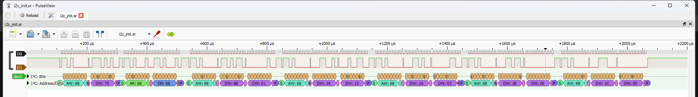
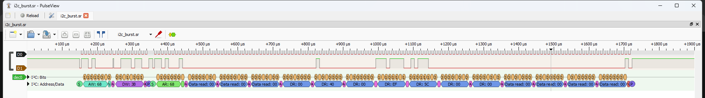
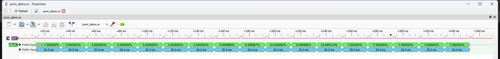
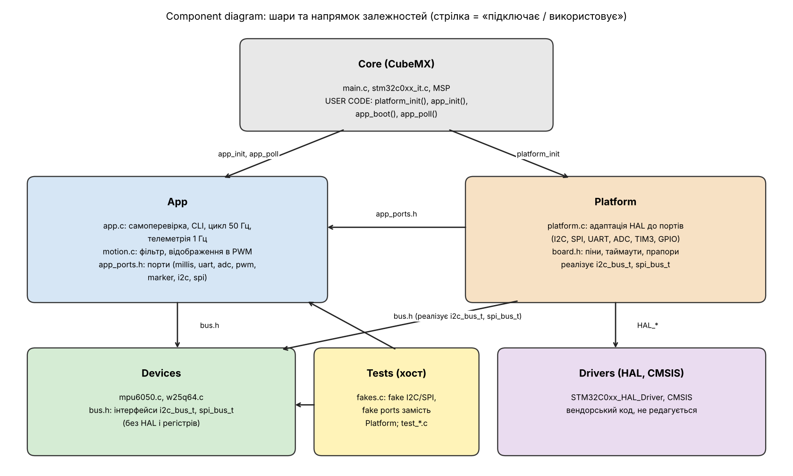

## Тема

Інтеграція сенсорної підсистеми: схема підключення, верифікація інтерфейсів логічним аналізатором, архітектура програмного проєкту.

## Мета роботи

Зібрати сенсорну підсистему проєкту Motion-Mirroring Teleoperator (MPU-6050 по I2C, SPI flash W25Q64, потенціометр на ADC, два сервоприводи на PWM, USART2) за обґрунтованою схемою підключення, довести правильність роботи кожного інтерфейсу записами логічного аналізатора, переробити прошивку у шарову архітектуру з відокремленням драйверів від HAL і покрити логіку хостовими тестами з автоматичною збіркою у CI.

## Форма виконання

Форма B (симулятор Wokwi), індивідуально. Плата NUCLEO-C031C6 (STM32C031C6, Cortex-M0+, 48 МГц). Фізичного стенда немає: «монтаж» виконується у `diagram.json`, мультиметр і PulseView не використовуються. Логічний аналізатор – `wokwi-logic-analyzer`, записи декодовано sigrok-cli 0.7.2, графіки побудовано з тих самих VCD (`tools/plot_captures.py`). Камери в цій конфігурації немає, тому питання конфлікту камери з іншими інтерфейсами не виникає (див. розд. 1). Репозиторій: `Zenzoik/lab-1-sprg`, гілка `lab2`, тег `lab2`.

## 1. Аргументація схеми підключення

Повна таблиця пінів з номерами роз'ємів, AF, напругами, підтяжками і джерелами – у `docs/pinout.md`; узгодженість таблиці з `firmware.ioc` та `diagram.json` перевіряє `make check-pinout`.

| Питання | Рішення | Аргумент (документ / вимірювання) |
|---|---|---|
| Чому I2C для MPU-6050 | I2C1, адреса 0x68 | MPU-6050 – I2C-пристрій (Product Specification); потрібні лише два дроти, один датчик на шині. Швидкість даних: 14 байтів за ≈1.37 мс при 100 кГц (виміряно), цикл керування 20 мс – запас у 14 разів |
| Чому 100 кГц, а не 400 кГц | TIMINGR = 0x10805D88, ≈100 кГц | Датчик допускає 400 кГц, але довші дроти на реальному макеті і підтяжки 4.7 кОм на GY-521 (tr ≈ 0.85·R·Cb) краще узгоджуються зі стандартним режимом; виміряний період SCL = 10.00 мкс |
| Чому SPI для flash | SPI1, mode 0, 3 МГц (48 МГц / 16) | W25Q64JV – SPI-пам'ять; mode 0 підтримується datasheet; 3 МГц – багато нижче межі 50 МГц для стандартного читання, SCK виміряно 3.08 МГц |
| Чому такий пін для CS# | PB0 (D10) як звичайний GPIO | Апаратний NSS піднімає CS між кадрами; команди flash (cmd + адреса + дані, WREN перед PP) вимагають керованого CS. PB0 – штатний D10 (UM2953) |
| Чому SCK на PB3, а не PA5 | PB3/PB4/PB5 (AF0) | PA5 – світлодіод LD4, PA6/PA7 зайняті TIM3 PWM |
| Чому окреме живлення серво | 5V (`5V.2`, `5V.3`) від окремого джерела на реальному залізі | SG92R у зупиненому стані тягне до ≈650 мА кожен (datasheet), лінія 3V3 і USB-порт ST-LINK цього не витримають; земля спільна |
| Чому така частота PWM | TIM3: PSC = 47, ARR = 19999 | 48 МГц / 48 = 1 МГц → тік 1 мкс, період 20 мс (50 Гц) – вимога серво; ширина 1000–2000 мкс виміряна |
| Чому UART на PA2/PA3 | USART2, 115200 8N1 | Лінії з'єднані з ST-LINK VCP на платі; BRR = 417 дає похибку −0.08 % |
| Чому окремий пін для маркера | PB1 (A3) | Службовий GPIO для вимірювання затримок; не збігається з LED, щоб його навантаження не спотворювало фронти |
| Як розв'язано конфлікт камери | Камеру в проєкт не включено | Камера не входить до PRD цього проєкту (форма B, STM32C031 до того ж не має інтерфейсу DCMI), тому шина камери не займає пінів; при її додаванні довелося б перевірити PA9/PA10 (I2C1) на можливе використання як SCCB |

Відхилені варіанти розводки (докладно у `docs/pinout.md`, розд. 6): A – SPI1 на PA5/PA6/PA7 (конфлікт з LD4 і TIM3); B – апаратний NSS (CS не утримується на всю команду); C – USART1 замість USART2 (VCP на PA2/PA3).

## 2. Інструкція з підключення

Збирає людина, яка не бачила проєкту. Масштаб – симулятор Wokwi; для залізної збірки порядок той самий.

1. Відкрити `diagram.json` у VS Code (розширення Wokwi). Усі з'єднання нижче вже задано в ньому; при ручному збиранні перетягувати дроти за таблицею.
2. Живлення і земля: 3V3 (`nucleo:3V3.2`) → VCC MPU-6050, VCC W25Q64, WP#, HOLD#; GND (`nucleo:GND.9`) → GND обох. Потенціометр: 3V3 (`3V3.1`) і GND (`GND.5`), середній вивід → A0.
3. I2C: SCL MPU-6050 → D8 (PA9), SDA → D2 (PA10). Адреса 0x68, AD0 – на GND.
4. SPI: CLK W25Q64 → D3 (PB3), DI → D6 (PB5), DO → D5 (PB4), CS → D10 (PB0).
5. Сервоприводи: PWM1 → D12 (PA6), PWM2 → D11 (PA7), V+ обох → 5V, GND → GND.
6. Кнопка: один контакт → PC13, другий → GND. UART: PA2/PA3 → `$serialMonitor` (на платі – ST-LINK VCP, кабель USB).
7. Логічний аналізатор: D0 → PA9, D1 → PA10, D2 → PB3, D3 → PB5, D4 → PB4, D5 → PB0, D6 → PA2, D7 → PA6, GND → GND. Для запису ADC використовується `docs/captures/adc/diagram.json` (D0 – маркер PB1).
8. Перевірка перед запуском: `make check-pinout` (таблиця ↔ ioc ↔ diagram); на реальному залізі – мультиметром 3.3 В між 3V3 і GND, відсутність КЗ між лініями, 5V окремо для серво.
9. Збірка і запуск: `make image && make build`, VS Code → F1 → `Wokwi: Start Simulator`. У терміналі має з'явитися `SELFTEST RESULT pass=8 fail=0`.

## 3. Верифікація пристроїв

Одна прошивка на старті послідовно перевіряє всі пристрої й друкує результат у машинозчитуваному вигляді `DEV <name> status=OK|FAIL <key=value ...>` (запис UART декодовано sigrok, `docs/captures/uart_selftest.txt`):

```
hello from STM32 (lr2)
SELFTEST BEGIN version=lr2 t_ms=4
DEV mpu6050_id status=OK addr=0x68 who=0x68 expected=0x68
DEV mpu6050_data status=OK ax_mg=0 ay_mg=0 az_mg=1000 norm_mg=1000 err_pct=0 temp_cdeg=2401
DEV w25q64_id status=OK jedec=EF4017 expected=EF4017
DEV w25q64_erase status=OK addr=0x001000 erase_ms=46 blank=1
DEV w25q64_rw status=OK addr=0x0010F8 len=16 prog_ms=4 match=1
DEV adc status=OK raw=0 mv=0 gain_pct=50
DEV button status=OK pressed=0
DEV pwm status=OK ch1_us=1500 ch2_us=1500 period_us=20000
SELFTEST RESULT pass=8 fail=0 t_ms=146
ANOMALY i2c_probe addr=0x69 result=NACK
ANOMALY spi_mode=3 jedec=FFFFFF expected=EF4017
```

| Пристрій | ID / ініціалізація | Правдоподібні дані |
|---|---|---|
| MPU-6050 | WHO_AM_I = 0x68; запис PWR_MGMT_1, SMPLRT_DIV, CONFIG, GYRO_CONFIG, ACCEL_CONFIG | |a| = 1000 мг (1 g, відхилення 0 %), температура 24.01 °C |
| W25Q64 | JEDEC EF 40 17 | стирання сектора 46 мс, запис 16 байтів з перетином сторінки і читання збігаються |
| Потенціометр (ADC) | – | raw = 0 при положенні 0 у схемі; при `value` = 75/1023 → raw = 300 (≈242 мВ) |
| Кнопка | – | не натиснута (0) |
| PWM | – | 1500 / 1500 мкс, період 20000 мкс |

Самоперевірка стійка до відмов: якщо пристрій не відповів, залежні перевірки друкують `status=FAIL skipped=<prereq>_failed`, тож кількість рядків `DEV` завжди дорівнює 8 (перевіряється тестами).

## 4. Аналіз записів логічного аналізатора

Повний аналіз з усіма таблицями – `docs/captures/analysis.md`; сирі записи і декодування – `docs/captures/*.vcd|.sr|.txt`; числа відтворюються `make decode` і `make measure`.

### 4.1 I2C


Декодування sigrok: `Start, Address write 68 ACK, Data write 75 ACK, Stop, Start, Address read 68 ACK, Data read 68 NACK, Stop`. Значення WHO_AM_I = 0x68 збігається з Register Map. Виміряно: період SCL 10.00 мкс (100.0 кГц), ширина високого рівня 5.00 мкс, запис регістра (START→STOP) 197.25 мкс, пакетне читання 14 байтів 1365 мкс. Розрахунок за TIMINGR 0x10805D88: tSCLL = 5.71 мкс, tSCLH = 3.92 мкс, період ≈ 9.63 мкс + фронти → збіг у межах 4 %.

Ручне декодування байта: SDA у моменти дев'яти наростаючих фронтів SCL = `1 1 0 1 0 0 0 0 | 0` → 0xD0 = (0x68 << 1) | 0 (запис), дев'ятий біт 0 – ACK.





Ініціалізація: PWR_MGMT_1 ← 0x01, SMPLRT_DIV ← 0x13 (50 Гц), CONFIG ← 0x03 (DLPF 44 Гц), GYRO_CONFIG ← 0x00 (±250 °/с), ACCEL_CONFIG ← 0x00 (±2 g). Пакетне читання (14 байтів від 0x3B): `00 00 00 00 40 00 EF 5C 00 …` → az = 16384 LSB = 1 g, температура 24.0 °C за формулою Register Map.


Аномалії: (1) адреса 0x69 (AD0 = VCC) – NACK на дев'ятому такті, SDA лишається високою; драйвер розрізняє `NACK` і `TIMEOUT`. (2) Між записом адреси регістра і читанням є STOP, а не повторний START (обхід моделі I2C у Wokwi); реальний чіп це приймає, але на залізі слід увімкнути `BOARD_I2C_REPEATED_START`.

### 4.2 SPI


sigrok (spiflash): `Read identification (RDID): Manufacturer 0xef, Memory type 0x40, Device ID 0x17` – збігається з W25Q64JV. Режим 0 (CPOL = 0, CPHA = 0): SCK у спокої низький, дані стабільні на наростаючому фронті. CS# утримується низьким усю команду. Виміряно: SCK 3.08 МГц (розрахунок 3 МГц), CS низький 240.75 мкс, CS↓ → перший фронт SCK 24.98 мкс, пауза 99.4 мкс між командою і відповіддю (два окремі виклики HAL).

Стирання і запис: `WREN → RDSR (WEL = 1) → SE 0x001000 → RDSR… (WIP)`; потім `WREN → RDSR → PP 0x0010F8, 8 байтів → RDSR…`. Write-enable передує кожній операції запису (окремі транзакції, CS піднімається між ними). Час стирання сектора ≈ 45.4 мс (типове значення в datasheet 45 мс).

Аномалія: при CPOL = 1, CPHA = 1 декодер mode 0 бачить `Unknown command: 0xcf` замість 0x9F; той самий запис, розібраний як `cpol=1:cpha=1`, дає коректні байти. Висновок: помилковий режим дає зсув на біт, що чітко видно на аналізаторі.

### 4.3 UART


Біт = 8.68 мкс (115274 бод за вимірюванням; фактично 48 МГц / 417 = 115108 бод). Символ 'h' = 0x68: після start-біта йдуть 0, 0, 0, 1, 0, 1, 1, 0 (LSB першим), потім stop. Текст декодовано sigrok (`hello from STM32 (lr2)`, рядки `DEV …`).

### 4.4 PWM



Демо-послідовність: 1000, 2000, 1500 мкс по 100 мс. Виміряно (округлено до 10 мкс): 1000, 1500, 2000 мкс; період 20000 мкс (50 Гц). sigrok pwm: duty 5.0 %, 7.5 %, 10.0 %.

### 4.5 ADC і службовий маркер


Маркер PB1 піднімається перед `HAL_ADC_Start`, опускається після читання. Виміряно (51 імпульс): ширина 63.60 мкс, період 19995.58 мкс (50.01 Гц), затримка спад маркера → START I2C 37.02 мкс. Розрахункова тривалість самого перетворення 0.58 мкс (14 тактів при 24 МГц), тож 63.6 мкс – це переважно накладні витрати HAL. Результат: raw = 300 (242 мВ) при `value` = 75 зі шкали 0–1023 (75/1023 · 3.3 В).

## 5. Структура проєкту

Шари: `Core` (CubeMX) – `App` (логіка) – `Devices` (драйвери) – `Platform` (HAL-адаптація) – `Drivers` (HAL/CMSIS); `Middlewares` порожній (сторонніх бібліотек немає). Залежності – тільки вниз: `App` бачить тільки `Devices`; `Devices` – тільки власні інтерфейси `bus.h`; HAL видно лише з `Platform` і `Core`. `App` отримує від `Platform` таблицю портів (`app_ports.h`), драйвери працюють через `i2c_bus_t` / `spi_bus_t`.

Правило перевіряється автоматично: `tools/check_deps.py` (`make check-deps`) розбирає `#include` і шукає символи `HAL_`, `LL_` та регістри STM32 в `App/` і `Devices/`; `--selftest` вставляє навмисне порушення і перевіряє, що перевірка падає. Збірка: `make build` у Docker, власний код з `-Wall -Wextra -Wshadow -Wpedantic -Werror` без попереджень. Модулі HAL, версії (CubeMX 6.18.1, FW_C0 V1.4.1, arm-none-eabi-gcc 10.3.1) і component diagram – у `docs/architecture.md`.



## 6. Результати тестування

`make test` запускає 69 перевірок без плати (Docker, gcc, fake-шини):

| Набір | Тестів | Що перевіряє |
|---|---|---|
| motion | 10 | isqrt, atan2 (таблиця + інтерполяція), pitch/roll, нормування вектора прискорення, відображення ADC у коефіцієнт підсилення 50..200 %, обмеження імпульсу 1000..2000 мкс |
| mpu6050 (fake I2C) | 16 | big-endian розбір пакета, вектор з реального запису (`00 00 00 00 40 00 EF 5C …`), формула температури, WHO_AM_I (ok / неправильне значення / NACK / неправильна адреса / timeout), послідовність ініціалізації дорівнює записаній, помилка шини посередині |
| w25q64 (fake SPI flash) | 18 | JEDEC EF 40 17 з запису, неправильний ID, неправильний SPI-режим, звільнення CS після помилки, **WREN перед PP**, PP без WREN ігнорується моделлю, розбиття запису на межі сторінки (0x10F8 + 16), «програма лише скидає біти», timeout BUSY/стирання, RDSR біти |
| app (fake board ports) | 25 | самоперевірка (усе OK / немає IMU / g поза діапазоном / нереальна температура / немає flash / write-protect / ADC), маркер охоплює читання ADC, CLI, цикл керування 50 Гц, телеметрія 1 Гц, втрата датчика центрує серво (FR-11), переповнення рядка |

Вектори в тестах узято з декодованих записів (байти пакета, JEDEC ID, послідовність ініціалізації), а приклад з datasheet – формула температури (−4260/340 + 36.53).

**Покриття** (`make coverage`, gcov/gcovr): рядки 95.4 % (496 з 520), гілки 77.9 % (240 з 308); `motion.c` 100 %, `app.c` 94 %, `mpu6050.c` 94 %, `w25q64.c` 95 %. Пороги: 90 % рядків і 70 % гілок – вимога падає у `make coverage` і CI. Обґрунтування: `Devices/` і `App/` не залежать від заліза, тож для них реально досягти високого покриття, а поріг 90 % ловить забуті шляхи; поріг гілок нижчий, бо багато гілок – ланцюжки перевірки коду повернення, у кожному кроці яких окремо перевіряється лише найчастіший збій. Не покриваються свідомо `Platform/` і `Core/` (залежать від HAL і регістрів, перевіряються в симуляторі та записами аналізатора), а в `App/Devices` – рядки `return st;` після другої/третьої помилки шини в багатокрокових функціях, обрізання буфера форматування, повідомлення про помилку використання CLI.

**Дефекти, знайдені тестами:**

1. Команда `reg` друкувала поля в зіпсованому форматі (`status`, `rc`, `hal`, `isr`, `data`), не придатному для розбору – знайшов тест `cmd: reg read`; виправлено у [edda2cc](https://github.com/Zenzoik/lab-1-sprg/commit/edda2cc).
2. Самоперевірка пропускала залежні перевірки (дані IMU, стирання і запис flash) без рядка у звіті, тому при відсутньому пристрої `SELFTEST` показував менше рядків, ніж перевірок – знайшов тест `selftest: IMU missing`; тепер друкується `status=FAIL skipped=…`, [edda2cc](https://github.com/Zenzoik/lab-1-sprg/commit/edda2cc).

## 7. Журнал проблем

**Проблема 1: збірка падала з помилкою лінкера `build/platform.o: No such file`.**
Симптом: `make build` компілював власні файли, але лінкер не знаходив `platform.o`. Root cause: у обгортці `Makefile.app` власні об'єкти не були пререквізитами ELF-цілі, а CubeMX-правило не знало про них. Виправлення: явна залежність `$(BUILD_DIR)/$(TARGET).elf: $(APP_OBJECTS)`, коміт [a988b20](https://github.com/Zenzoik/lab-1-sprg/commit/a988b20).

**Проблема 2: `main.c` не компілювався (незбалансовані фігурні дужки).**
Симптом: помилка компілятора після вставки викликів у USER CODE. Root cause: закриваюча `}` циклу `while (1)` не потрапила у згенерований файл при автоматичній вставці викликів у USER CODE. Виправлення: `}` повернено після `USER CODE END 3`, [fd0fa5e](https://github.com/Zenzoik/lab-1-sprg/commit/fd0fa5e).

**Проблема 3: WHO_AM_I повертав 0, MPU-6050 відповідав NACK.**
Симптом: `HAL_I2C_Mem_Read` завершувався помилкою, на аналізаторі – запис адреси регістра, потім нічого. Root cause: модель I2C у Wokwi не підтримує повторний START у тій формі, у якій його формує HAL C0 (прапор TC), тому читання регістра не доходило до фази читання. Виправлення: регістровий poll-драйвер (`i2c_xfer`) з фазою запису, STOP і окремим читанням; повторний START залишено за прапором `BOARD_I2C_REPEATED_START` для залізної збірки, [edda2cc](https://github.com/Zenzoik/lab-1-sprg/commit/edda2cc).

**Проблема 4: двобайтний запис у регістр зависав (SCL = 0, SDA = 1).**
Симптом: запис `PWR_MGMT_1 ← 0x01` ставав без другого байта, шина лишалася зайнятою, наступні транзакції давали BUSY. Root cause: модель I2C у Wokwi губить другий запит TXIS багатобайтного запису, поки контролер I2C не пройшов скидання PE. Виправлення: PE-скидання перед кожною транзакцією (`BOARD_I2C_RESET_BEFORE_XFER`), відновлення після таймауту перемиканням PE, [edda2cc](https://github.com/Zenzoik/lab-1-sprg/commit/edda2cc).

**Проблема 5: gcovr не знаходив вихідні файли (`Cannot open source file`).**
Симптом: тести проходили, але звіт покриття порожній. Root cause: gcov зберігає у `.gcno` відносні шляхи, а компіляція виконувалася з теки `tests/`. Виправлення: компіляція покриття з абсолютними шляхами (`$(abspath …)`), [5f11749](https://github.com/Zenzoik/lab-1-sprg/commit/5f11749).

**Проблема 6: sigrok-cli завис на повному записі (96 с).**
Симптом: декодування VCD на 15 МБ не завершувалося за хвилини, опція `-I vcd:samplerate=` не підтримується. Root cause: sigrok перетворює VCD у рівномірні відліки з частотою найдрібнішого інтервалу (25 нс), і 96 с дають мільярди відліків. Виправлення: `tools/vcd_tool.py window` вирізає короткі вікна, `tools/decode_captures.py` відтворює всі декодування, [4acc4fe](https://github.com/Zenzoik/lab-1-sprg/commit/4acc4fe).

**Проблема 7: ADC завжди дорівнював 0, а після зміни схеми нічого не змінювалося.**
Симптом: `adc raw=0` у терміналі, перезапуск симулятора не міняв результат після редагування `diagram.json`. Root cause: двоскладова. По-перше, потенціометр у `diagram.json` не мав атрибута `value`, тобто стояв у положенні 0 (0 В → raw = 0 – коректний результат). По-друге, кнопка «Restart» перезапускає прошивку, але не перечитує схему; зміни схеми діють лише після повної зупинки і нового запуску. Виправлення: повна зупинка і запуск, атрибут `value` = 75 у `docs/captures/adc/diagram.json` → raw = 300 (242 мВ), що збігається з 75/1023 · 3.3 В, [b229477](https://github.com/Zenzoik/lab-1-sprg/commit/b229477).

**Проблема 8: shell-скрипти і Makefile з CRLF не запускалися у WSL/Docker.**
Симптом: `$'\r': command not found`, `*** missing separator`. Root cause: редагування у Windows додавало CRLF. Виправлення: `.gitattributes` з `eol=lf` для `*.sh`, `Makefile`, `*.yml`, `*.py`, [a988b20](https://github.com/Zenzoik/lab-1-sprg/commit/a988b20).

## 8. Що неможливо перевірити в симуляторі і як перевірити на залізі

| Що не перевіряється у Wokwi | Як перевірити на реальному обладнанні |
|---|---|
| Фронти SDA/SCL, ємність шини, номінал pull-up (модель ідеальна) | Осцилограф: tr < 1 мкс при 100 кГц (UM10204); перевірити 4.7 кОм на GY-521; при потребі зменшити pull-up |
| Повторний START і багатобайтні I2C-транзакції у «чистому» HAL | Зібрати з `BOARD_I2C_REPEATED_START=1`, `BOARD_I2C_RESET_BEFORE_XFER=0`; порівняти запис з рис. 1 |
| Мінімальний tHIGH SCL (розрахунок 3.92 мкс < 4.0 мкс стандартного режиму) | Виміряти осцилографом, збільшити SCLH у TIMINGR на 2–3 одиниці |
| Час вибірки ADC 1.5 такту для джерела 10 кОм | Виміряти шум і лінійність на потенціометрі; збільшити час вибірки або поставити конденсатор |
| Споживання, просадка 5 В при русі серво, спільна земля | Мультиметр і осцилограф на 5V при русі; окреме джерело 5 В |
| SPI на реальній частоті, довжина дротів до flash | Підняти SCK до 12–24 МГц, перевірити на аналізаторі з частотою дискретизації ≥ 4× SCK |
| Накладні витрати HAL (CS низький 240 мкс замість 10.7) | Виміряти на залізі; замінити на один `HAL_SPI_TransmitReceive` або LL-реалізацію |
| Захист і скидання (IWDG), пошкодження flash при втраті живлення | Відключити живлення під час стирання і перевірити відновлення |

Мінімальна частота дискретизації аналізатора: ≥ 4× частота сигналу, тобто ≥ 12 МГц для SPI 3 МГц і ≥ 400 кГц для I2C 100 кГц; симулятор експортує події з роздільністю 25 нс (40 МГц).

## 9. Внесок учасників

Лабораторну виконано індивідуально; усі шість напрямів виконав Зернишкін І. Д.

| № | Напрям | Артефакти | Виконавець | Частка |
|---|---|---|---|---|
| 1 | Звіт і документація | `docs/lab2-report.md`, `LR2_report.docx/.pdf`, відеосценарій | Зернишкін І. Д. | 100 % |
| 2 | Документація і pinout | `docs/pinout.md`, `tools/check_pinout.py`, `.ioc` (піни) | Зернишкін І. Д. | 100 % |
| 3 | Робота з апаратурою (симулятор) | `diagram.json`, `chips/w25q64`, записи VCD/.sr | Зернишкін І. Д. | 100 % |
| 4 | Декодування і аналіз | `docs/captures/analysis.md`, `tools/measure.py`, `tools/plot_captures.py` | Зернишкін І. Д. | 100 % |
| 5 | Структура проєкту і збірка | `firmware/**`, `Makefile`, `.github/workflows/ci.yml`, `tools/check_deps.py` | Зернишкін І. Д. | 100 % |
| 6 | Тестування | `tests/**`, звіт покриття | Зернишкін І. Д. | 100 % |

## 10. Сценарій відеозвіту (2–3 хв)

0:00–0:20 – відкрити репозиторій, показати структуру (`firmware/Platform|Devices|App`, `tests`, `docs/captures`) і `docs/pinout.md`; пояснити, чому SCK на PB3, а не PA5.
0:20–0:50 – VS Code: `make build` (без попереджень), запуск симулятора Wokwi, показати схему з MPU-6050, W25Q64, двома серво і логічним аналізатором.
0:50–1:20 – термінал Wokwi: вивід самоперевірки (`SELFTEST RESULT pass=8 fail=0`), команди `adc`, `reg 68 75`, `pwm`.
1:20–2:10 – аналіз записів: `analysis.md` та рисунки (I2C WHO_AM_I і ручне декодування 0xD0, SPI JEDEC EF 40 17 і WREN перед PP, UART біт 8.68 мкс, PWM 1000/1500/2000 мкс, маркер ADC і затримка 37 мкс); показати аномалію NACK 0x69. Примітка: PulseView у формі B не використовується, фрагмент роботи з декодерами показується через sigrok-cli (`make decode`).
2:10–2:40 – `make test` (69 перевірок), `make coverage` (95.4 % / 77.9 %), `make check`, зелений CI.
2:40–3:00 – розбір обмежень симулятора (розд. 8) і що перевірити на залізі.

## 11. Відповіді на контрольні питання

**1. Datasheet МК, reference manual і user manual плати.** Datasheet (DS STM32C031x6) – електричні характеристики, розпіновка і таблиця альтернативних функцій конкретного кристала; reference manual (RM0490) – опис периферії і регістрів, спільний для сімейства; user manual плати (UM2953) – як піни виведено на роз'єми і що з'єднано на платі (ST-LINK VCP, LD4, USER-кнопка). Для вибору SCK: AF0 для PB3 – datasheet, регістри SPI1 і формула швидкості – RM0490, зайнятість PA5 світлодіодом LD4 і D10 для PB0 – UM2953.

**2. Open-drain на I2C.** Шина – проводове «І»: будь-який учасник може лише притягнути лінію до землі, а високий рівень задає pull-up. При push-pull два учасники з різними рівнями дали б коротке замикання через виходи, а клок-стретчинг і арбітраж неможливі. На аналізаторі це проявилося б у спотворених рівнях і SDA, що не повертається до високого.

**3. Номінал pull-up.** Залежить від ємності шини Cb, режиму (час наростання tr ≤ 1000 нс для 100 кГц, ≤ 300 нс для 400 кГц; tr ≈ 0.85·R·Cb), максимального струму низького рівня (≈ 3 мА) і напруги живлення. Кілька модулів із власними pull-up з'єднуються паралельно, еквівалентний опір падає і струм при низькому рівні росте; тому зайві підтяжки треба знімати.

**4. SCCB та I2C.** SCCB (OmniVision) – спрощений двопровідний протокол, схожий на I2C, але дев'ятий біт кожного байта – «don't care» (пристрій може не підтверджувати), немає повторного START у стандартному читанні (читання – дві окремі транзакції: запис адреси регістра, потім читання) і немає багатобайтних транзакцій. Стандартний HAL I2C очікує ACK/NACK і повертає помилку на «don't care», а `HAL_I2C_Mem_Read` формує повторний START – тому для камер з SCCB потрібна окрема послідовність write + STOP + read. У цьому проєкті камери немає.

**5. CPOL і CPHA.** CPOL – рівень SCK у спокої, CPHA – по якому фронту вибираються дані (перший чи другий). Flash W25Q64 використовує mode 0 (CPOL = 0, CPHA = 0; підтримує також mode 3). Підтверджено записом: SCK у спокої низький, біти MOSI стабільні на наростаючому фронті, JEDEC EF 40 17 декодується в mode 0, а при CPOL = 1, CPHA = 1 декодер бачить `0xCF`.

**6. Програмний CS#.** Апаратний NSS піднімається між кадрами, а команди flash складаються з кількох передач (cmd + адреса + дані), під час яких CS має бути низьким; також треба піднімати CS між WREN і PP. Програмний CS на GPIO (PB0) дає точний контроль.

**7. Частота дискретизації.** Приблизно ≥ 4× частота сигналу: для SPI 3 МГц – ≥ 12 МГц, для I2C 100 кГц – ≥ 400 кГц, UART 115200 – ≥ 460 кГц (найменший елемент – біт 8.68 мкс), PWM 50 Гц – достатньо ≈ 100 кГц для вимірювання ширини 1 мс із точністю 10 мкс. Зверху обмежує пам'ять аналізатора й смуга/частота входів; у Wokwi – роздільність 25 нс і обсяг запису (96 с дали 15 МБ VCD).

**8. APB і частоти периферії.** I2C: TIMINGR задається від частоти тактування I2C (48 МГц): PRESC = 1 → tPRESC = 41.67 нс, tSCLL = 137 · 41.67 нс = 5.71 мкс, tSCLH = 94 · 41.67 нс = 3.92 мкс → ≈ 100 кГц. SPI: 48 МГц / 16 = 3 МГц. UART: BRR = 48 МГц / 115200 = 416.67 → 417. TIM3: 48 МГц / 48 = 1 МГц, ARR 19999 → 50 Гц. Зменшення APB зменшило б усі ці значення, тож TIMINGR, BRR і PSC довелося б перераховувати.

**9. Живлення серво.** Серво у русі споживають сотні міліампер (до ≈650 мА в зупиненому стані), стабілізатор 3V3 і USB-порт цього не дають; піки струму викликають просідання напруги і скидання МК. Земля має бути спільною, бо рівень сигналу PWM визначається щодо землі МК: без спільної землі серво не побачить логічного рівня.

**10. Шари і гарантія.** Core → App → Devices; Platform реалізує інтерфейси Devices і App, HAL бачить лише Platform і Core. Гарантує `tools/check_deps.py` (перевірка `#include` і заборона `HAL_` у App/Devices) та його `--selftest`, які входять у `make check` і CI, а також те, що App/Devices компілюються у хостових тестах без заголовків STM32.

**11. Доступ драйвера до шини.** Через структуру `i2c_bus_t` / `spi_bus_t` (вказівники на `write`, `read`, `xfer`, `cs`), яку передають у `mpu6050_init()` / `w25q_init()`. У прошивці її заповнює `Platform/platform.c` (HAL), у хостовому тесті – `tests/fakes.c` (підроблена шина і модель flash), драйвер при цьому той самий об'єктний код.

**12. Fake і mock.** Fake – проста робоча реалізація залежності (у нас: `fake_spi_flash` з моделлю пам'яті, WEL, WIP, стиранням, що працює як реальна flash). Mock – об'єкт, що записує виклики і перевіряє очікувану поведінку. Mock потрібен у тестах «WREN перед PP» і «every PP has its own WREN»: перевіряється точна послідовність команд на шині (журнал `log[]`), а не лише результат; так само `WEL not latched -> error, no PP/SE sent` (перевіряє, що команди не були відправлені).

**13. Що не покрито.** `Platform/` і `Core/` (залежать від HAL і регістрів – їх перевіряють симулятор і записи аналізатора), рядки `return st;` після другої/третьої помилки шини, обрізання буфера форматування, повідомлення про помилку використання CLI. Причина: вони або залежать від заліза, або їх досягнення потребує штучних сценаріїв, що не додають довіри.

## Висновки

Сенсорна підсистема зібрана за обґрунтованою схемою (14 пінів, перевірених проти `.ioc` і `diagram.json`), усі пристрої підтверджені самоперевіркою в одній прошивці (8 з 8 OK), I2C/SPI/UART/PWM/ADC перевірені записами аналізатора: SCL 100.0 кГц, SCK 3.08 МГц, біт UART 8.68 мкс, PWM 1000/1500/2000 мкс при 50 Гц, JEDEC EF 40 17, затримка маркер → I2C 37 мкс; знайдено й пояснено аномалії (NACK 0x69, SPI mode 3, відсутність повторного START). Прошивка переведена в шарову архітектуру з автоматичною перевіркою залежностей, 69 хостових тестів (покриття 95.4 % рядків і 77.9 % гілок) виконуються в CI разом зі збіркою. Обмеження: форма B не дозволяє перевірити електричні параметри шин, живлення серво і час вибірки ADC – план перевірки на залізі наведено в розд. 8.

## Додаток. Скриншоти виконання

Усі скриншоти зроблено на робочому ПК під час виконання роботи (Windows, WSL2, Docker-образ stm32-build-lr2, VS Code з розширенням Wokwi, STM32CubeMX).


## Матеріали та посилання

- Репозиторій: https://github.com/Zenzoik/lab-1-sprg (гілка `lab2`, тег `lab2`)
- Документи: `docs/pinout.md`, `docs/architecture.md`, `docs/captures/analysis.md`, `docs/PRD.md`, `docs/hardware-components.md`
- UM2953 (Nucleo-64 C0), DS STM32C031x6, RM0490, PS/RM-MPU-6000A, W25Q64JV, NXP UM10204, sigrok.org
- Відеозвіт: посилання на Google Drive (додати після запису)
