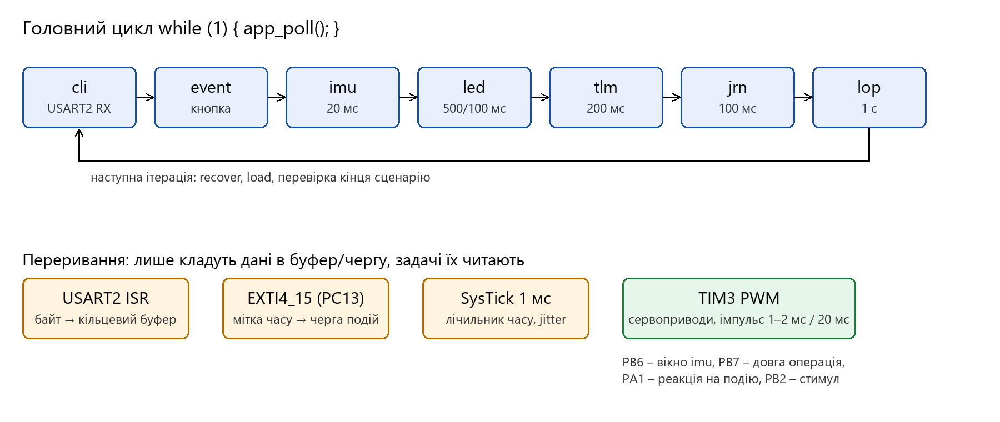
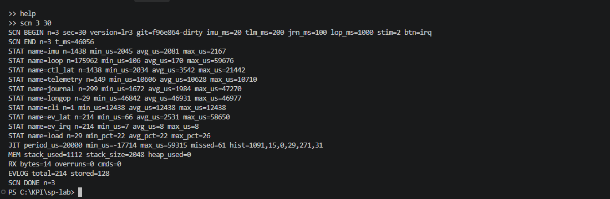
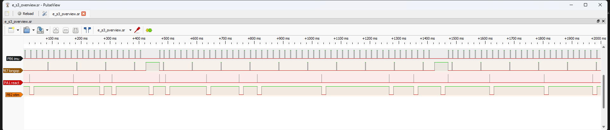
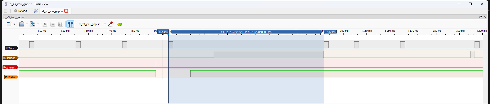
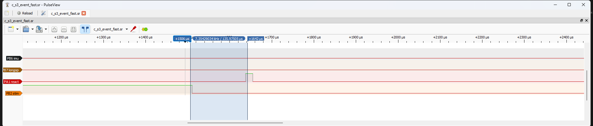
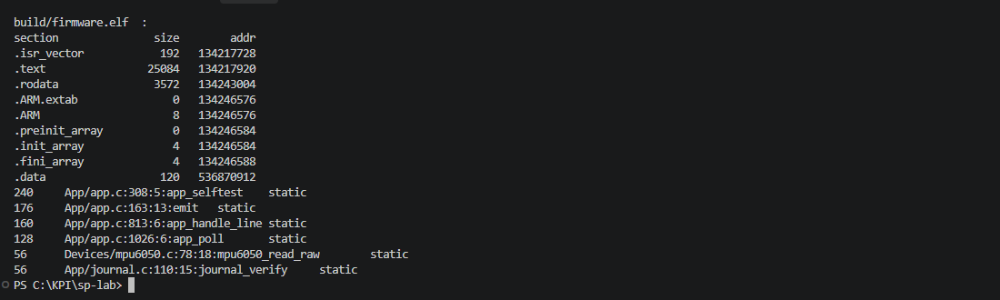

## Мета роботи

Зібрати прошивку Motion-Mirroring Teleoperator у вигляді головного циклу (super loop) на STM32C031C6, виміряти час виконання задач, джитер, затримку реакції на подію, завантаження CPU і пам'ять, знайти навантаження, за якого вимоги PRD порушуються, і зробити висновок, чи потрібна продукту ОС.

Форма B: фізичного стенда немає, прошивка працює у симуляторі Wokwi (VS Code). Тому всі числа – з симулятора. Абсолютний час стирання flash задає модель W25Q64, а не кристал, тож довіряти можна співвідношенням і збігу двох способів вимірювання, а не мілісекундам як таким.

## 1. Стан вимог

| FR | Вимога | Стан | Чим перевірено |
|---|---|---|---|
| FR-01 | `hello` < 1 с | виконано | `boot` ×5: перше повідомлення через 7 мс, самотест 146 мс |
| FR-02 | виявлення MPU-6050 | виконано | самотест, `whoami` |
| FR-03 | опитування IMU ≥ 50 Гц | з обмеженням | S1: 0 пропусків; S2: 2; S3: 61 |
| FR-04 | похибка кута ≤ 5° | виконано | хостові тести `motion` |
| FR-05 | сервоприводи 1000–2000 мкс / 20 мс | виконано | тести, команда `pwm` |
| FR-06 | зміна → PWM < 50 мс | з обмеженням | S1 22,2 мс; S2 68,9 мс; S3 81,4 мс |
| FR-07 | потенціометр керує амплітудою | виконано | команда `adc` |
| FR-08 | кнопка: центрування, режим | з обмеженням | `press 100` / `press 1500`; у S3 реакція до 58,7 мс |
| FR-09 | LD4 за режимом | виконано | хостові тести |
| FR-10 | 10 ± 1 рядок телеметрії за 10 с | з обмеженням | S2 стабільно; у S3 телеметрія їсть до 26 % CPU |
| FR-11 | відмова датчика: PWM 1500, повідомлення | виконано | сценарій F1, `recover` до 4,7 мс |

«З обмеженням» означає: у S1 вимога виконується, у важчих режимах – ні. Це головний результат роботи.

## 2. Будова прошивки

`main()` після ініціалізації та самотесту крутить `while (1) { app_poll(); }`. Кожна задача сама дивиться на лічильник часу і, якщо ще не її черга, одразу повертає керування. Періоди й дедлайни – у `docs/tasks.md`.

Кнопка PC13 працює через EXTI4_15 (у CubeMX увімкнено лінію переривання та NVIC), стимул для тестів – перемичка PB2 → PC13. Для режиму «опитування» лінія знімається через `HAL_GPIO_DeInit`.

Схема в Wokwi: до плати NUCLEO-C031C6 підключено MPU-6050, W25Q64, два сервоприводи, потенціометр, кнопку і логічний аналізатор. Канали аналізатора: D0 = PB6 (вікно `imu`), D1 = PB7 (довга операція), D2 = PA1 (початок обробки події), D3 = PB2 (стимул).

Перевірки: `make test` проходить повністю (69 тестів з ЛР2 і 29 нових).

## 3. Як вимірював

1. Одна збірка, чотири набори налаштувань: S1, S2, S3 задаються командою `scn`, решта – командою `set`. Прогін робить `tools/run_scenarios.py`, команди друкуються по символу з паузою 20 мс (інакше термінал Wokwi губить байти).
2. Лічильник МК: у Cortex-M0+ немає DWT, тому лічильник циклів зроблено на SysTick. Для кожної задачі виводяться `n`, `min`, `avg`, `max` у мкс.
3. Логічний аналізатор: запис усієї сесії зберігається у `wokwi.vcd` після кнопки Stop, далі `sigrok-cli` перетворює його у `.sr`, а дивлюся у PulseView. Курсорами міряв інтервали.
4. Джитер = фактичний інтервал між запусками `imu` мінус 20 мс. Інтервал ≥ 30 мс вважаю пропуском.
5. Затримка події = від фронту PB2 до фронту PA1.
6. Пам'ять: `--print-memory-usage`, `size -A`, `nm --size-sort`, stack painting для стека.

## 4. Результати S1, S2, S3

| Метрика | S1 | S2 | S3 | Вимога |
|---|---|---|---|---|
| `imu`, avg / max | 2,08 / 2,09 мс | 2,08 / 2,12 мс | 2,08 / 2,17 мс | – |
| Max інтервал між запусками `imu` | 20,1 мс | 66,8 мс | 79,3 мс | ≤ 20 мс |
| Пропущено періодів | 0 | 2 | 61 | 0 |
| FR-06, найгірший випадок | 22,2 мс | 68,9 мс | 81,4 мс | < 50 мс |
| Затримка події, max | – | 1,98 мс | 46,5 / 58,7 мс | ≤ 50 мс |
| CPU, avg / max | 10 / 11 % | 12 / 16 % | 22 / 26 % | – |
| Стек | 1128 Б | 1128 Б | 1112 Б | резерв 2048 Б |
| Heap | 0 | 0 | 0 | – |

Для S3 зроблено два прогони, тому два значення затримки події; різниця залежить від того, як натискання потрапили відносно стирання flash.

Вивід прошивки для S1 (близько 10 % CPU, джитер ±0,12 мс, пропусків немає):

І для S3 (джитер до 59 мс, 61 пропуск, завантаження 22 %):

Цікаво, що середнє завантаження S3 всього 22 %, а вимоги все одно порушено. Справа не в сумі, а в найдовшій задачі, яку не можна перервати: стирання сектора блокує цикл на ≈ 47 мс.
## 5. Що показав аналізатор

У S1 вікно `imu` (PB6) має ширину 2 мс і йде з періодом 20 мс.

У S3 картина інша. Загальний вигляд двох секунд: імпульси `imu` рівні, поки немає довгих операцій, а на кожну довгу операцію PB7 (широкі прямокутники) припадає пропуск у PB6.

Один такий пропуск зблизька: між двома сусідніми імпульсами `imu` 67 мс замість 20.

Реакція на подію. Коли цикл вільний, PA1 піднімається приблизно через 136 мкс після фронту PB2:

А якщо кнопку натиснуто під час стирання, PA1 піднімається лише коли PB7 опускається, тобто через 46 мс:

Різниця більше ніж у 300 разів, і це та сама подія та сама прошивка.

## 6. Інші сценарії

**Довга операція + періодична (L1, 20 с).** Без `lop` – 999 запусків `imu`, джитер 118 мкс. Зі стиранням flash раз на секунду – 961 запуск, джитер 46,5 мс, 38 пропусків.

**Подія під час довгої операції (E1–E3).**

| | E1: EXTI, цикл вільний | E2: EXTI, `lop` 500 мс | E3: опитування, `lop` 500 мс |
|---|---|---|---|
| Подій | 41 | 37 | 36 з 37 |
| Max затримка | 1,73 мс | 40,2 мс | 1,56 мс |

У E3 максимум малий лише тому, що одне натискання потрапило у стирання і зникло. Опитування для продукту не підходить, а EXTI з чергою події зберігає, але швидше їх не обробляє.

**Потік команд UART (U1, U2).** Надіслано ≈ 7900 команд `ping`, оброблено 1051 (S2) і 844 (S3), тобто 11–13 %. Лічильник overrun показує 0, бо Wokwi не емулює прапор ORE, тому втрати встановлено за балансом надісланих і оброблених.

**Відмова датчика (F1, 40 с).** Прошивка переходить у `ERROR`, обидва PWM = 1500 мкс, виводиться повідомлення, після повернення датчика режим відновлюється. `recover` до 4,67 мс.

**Точки зламу (B_*).** `imu` 1 мс: ефективний період 2,55 мс, 6072 пропуски. `tlm` 10 мс: завантаження 98 %. `lop` 60 мс: 81 % і `imu` губить близько 75 % запусків.

**Година роботи (S2, 3600 с).** 179 581 запуск `imu`, стек 1128 Б і heap 0 не змінились, журнал цілий (`bad=0`) після 26 стирань сектора, 32-бітний лічильник близько 40 разів перетнув межу 89 с без збоїв. Великі максимуми в цьому прогоні (до 0,75 с) дає команда `jv`, яку я сам запускав кожні 5 хв: вона синхронна і блокує цикл.

**Boot ×5 і журнал.** П'ять запусків ідентичні. Команда `jtorn` імітує обірваний запис, `jv` після неї знаходить `bad=1`, наступні записи не втрачаються.

Перевірка кнопки (FR-08): коротке натискання режим не змінює, довге перемикає Hold/Live.

## 7. Лічильник МК проти аналізатора

| Метрика | Лічильник МК | Аналізатор |
|---|---|---|
| Ширина вікна `imu` | 2082 мкс | 2020 мкс |
| Період `imu` у S1 | 20000 мкс (джитер −111 / +125 мкс) | 20000,4 мкс |
| Затримка події, S3, p50 | ≈ 159 мкс | 162,8 мкс |
| Затримка події, S3, max | 46,5 мс (один прогін), 58,7 мс (інший) | 46,2 мс |

Ширина вікна розходиться на 62 мкс (3 %): лічильник міряє від входу в задачу до виклику `perf_end`, пін піднімається вже всередині задачі. Решта збігається. Аналізатор у новому прогоні записав 194 події. Висновок: лічильнику можна вірити, поправка відома і мала.

## 8. Пам'ять

З `--print-memory-usage` (LTO, `-Os`): FLASH 29 156 Б із 32 КБ (88,98 %), RAM 5128 Б із 12 КБ (41,73 %). `.data` 120 Б, `.bss` 2448 Б, під стек зарезервовано 2 КБ. Без LTO прошивка не влазить (104 %). Вільно 3,6 КБ flash – це обмеження для ЛР4: ядро RTOS тут не вміститься без викидання діагностики.

Стек: статична оцінка (`-fstack-usage`) для найглибшого шляху близько 464 Б без newlib, виміряно stack painting 1128 Б. Виміряне більше, бо статика не бачить викликів через вказівники (таблиця команд) і ISR поверх `printf`. Перша спроба з резервом 1 КБ показала насичення на 1024 Б: справжні 1128 Б виходили за резерв. Heap 0, динамічної пам'яті немає.
## 9. Обмеження

| № | Обмеження | Доказ | Що дасть ОС |
|---|---|---|---|
| LIM-1 | Реакція на подію = найдовша задача циклу | 46–58 мс проти 0,16 мс у вільному циклі | витіснення, реакція < 1 мс |
| LIM-2 | Довга операція руйнує періодичність `imu` | 38 пропусків у L1, 61 у S3 | `imu` витісняє `lop` |
| LIM-3 | Блокувальна телеметрія | `tlm` 10 мс: 98 % CPU | передача в окремій задачі |
| LIM-4 | Втрата байтів UART | оброблено 11–13 % команд | не ОС, а DMA/переривання |
| LIM-5 | Відмова датчика блокує цикл на timeout | до 20 мс на транзакцію (оцінка за кодом) | блокується лише одна задача |
| LIM-6 | Нова задача зачіпає код у багатьох місцях | `lop`: ≈ 10 змін у `app.c` | реєстрація в одному місці |
| LIM-7 | Один стек на все | 1128 Б | стек на задачу, RAM ×3–5 |

Обмеження вимірювань: Wokwi не циклоточний (на кристалі sector erase зазвичай 45–400 мс, тож LIM-1/2 там гірші); overrun UART завжди 0; тайм-аут датчика на залізі я не міряв, тільки оцінив за кодом; два прогони S3 дали різні максимуми, для вимог беру більший.

## 10. Проблеми, які були

| № | Що бачив | Причина | Що зробив |
|---|---|---|---|
| 1 | Стек «упирався» у 1024 Б | stack painting малювався лише в межах резерву, справжня глибина 1128 Б | малювання від `_end`, резерв 2 КБ |
| 2 | У режимі опитування кнопка давала дві події | `HAL_GPIO_Init` не знімає EXTI | `HAL_GPIO_DeInit` перед повторною ініціалізацією |
| 3 | Команди губилися або `unknown command` | термінал Wokwi губить байти пакета і хоче `\r` | друк по символу з паузою 20 мс |
| 4 | `region FLASH overflowed`, 104 % | без LTO не влазить у 32 КБ | `-flto -Os` → 88,98 %; для стека окремий `stack_static.sh` |
| 5 | Запис аналізатора обривався на ≈ 33 мс | обмежений буфер тригерного режиму | запис усієї сесії через Stop, фрагмент вирізаю скриптом |
| 6 | У S3 `ctl_lat` 21 мс при інтервалі між відліками 79 мс | `ctl_lat` не враховує пропущені відліки | рахую пропуски окремо, для FR-06 беру max інтервал + 2,1 мс |
| 7 | Довгий прогін S2 раптом обривався | перезбірка ELF перезапускає симулятор | перезбираю тільки між прогонами |

## 11. Висновок

Для S1 super loop цілком достатній: інтервал 20,1 мс, FR-06 22,2 мс, CPU 10 %. У S2 ламається лише FR-06 у найгіршому випадку (68,9 мс) через запис журналу. У S3 super loop не тримає FR-03, FR-06 і реакцію на кнопку, хоча CPU завантажений лише на 22 %. Причина – неперервні блокувальні задачі (стирання flash ≈ 47 мс, телеметрія, журнал), які цикл перервати не може.

Якщо продукт має одночасно вести журнал у flash і тримати 50 Гц, потрібне витіснення: RTOS або принаймні розбиття довгих операцій на кроки. LIM-1, 2, 3 і 5 вирішуються пріоритетами й чергами, LIM-4 – DMA. Ціна: вільних 3,6 КБ flash замало, а стеки задач збільшать RAM у 3–5 разів. Тому ЛР4 починається з бюджету пам'яті (`docs/baseline-lab4.md`).

## 12. Внесок

Форма B, робота індивідуальна, усі ролі виконав Зернишкін І. Д.: прошивка і вимірювальний код (`firmware/App`), сценарії та скрипти (`tools/`), запис і аналіз логічного аналізатора, реєстр обмежень і базова лінія для ЛР4. Історія – у `git log` гілки `lab3`.

## 13. Сценарій відеозвіту (2–3 хв)

1. 0:00–0:20: схема у Wokwi, термінал, команда `scn 3 30`.
2. 0:20–1:00: рядки `STAT`, завантаження 22 %, натискання кнопки під час довгої операції і затримка події.
3. 1:00–1:40: PulseView із записом S3: PB2 → PB7 (стирання) → PA1, курсорами показати 46 мс.
4. 1:40–2:10: той самий кадр при вільному циклі, 136 мкс.
5. 2:10–2:50: висновок, що S3 не виконує FR-06, потрібна ОС, таблиця бюджету пам'яті.

## 14. Відповіді на контрольні питання

1. **Головний цикл.** `while (1) { app_poll(); }`, у `app_poll` задачі `cli → event → imu → led → tlm → jrn → lop → recover → load`. Найгірша затримка реакції T_resp = T_longest + T_isr + T_event. У нас T_longest ≈ 47 мс (стирання), T_event ≈ 0,16 мс, виміряно max 46,5–58,7 мс.
2. **Джитер** – відхилення фактичного інтервалу між запусками періодичної задачі від періоду. У S1 −111/+125 мкс, у S3 до 59 мс, через стирання flash і телеметрію.
3. **Найгірший час, а не середній.** Середнє CPU в S3 22 %, але інтервал до 79 мс. Максимум підтверджено лічильником, аналізатором і повторним прогоном.
4. **Лічильник циклів.** На M0+ немає DWT, тому SysTick: `m·(LOAD+1) + (LOAD−VAL)`. Різниця беззнакових 32-бітних значень коректна за модулем 2³², поки інтервал менше 2³² тактів, тобто 89 с при 48 МГц.
5. **Час приходу рядка на хості** містить буферизацію віртуального порту і планувальник ОС (мілісекунди розкиду), тому час беремо з лічильника МК і аналізатора.
6. **В ISR** можна читати прапор, класти мітку в кільцевий буфер, скидати EXTI. Не можна `printf`, flash, HAL із timeout: він залежить від `HAL_GetTick`, а SysTick при такому самому пріоритеті не спрацює, і виклик зависне.
7. **`volatile`** не дає компілятору кешувати значення, але не гарантує атомарність кількох змінних. Для кільця подій (`head`, `tail`, дані) важливий порядок: спочатку дані, потім індекс.
8. **text / data / bss.** `text` – код і константи у flash (25 084 + 3572 Б), `data` – ініціалізовані змінні (120 Б), `bss` – обнулені (2448 Б). Стек і heap у цій таблиці не видно, їх міряємо під час роботи.
9. **Статичний і виміряний стек.** Статика (`-fstack-usage`) – сума кадрів найглибшого шляху, не бачить викликів через вказівники і ISR. Виміряне (stack painting) – реальне за прогін, у нас 1128 Б проти ≈ 464 Б.
10. **RAM і кадр.** Камери немає. Вільно ≈ 7 КБ RAM: кадр 80×60×8 біт (4800 Б) вміститься, 160×120 (19 200 Б) – ні.
11. **Датчик I²C не відповідає.** Транзакція чекає timeout (за кодом 20 мс), прошивка переходить у `ERROR`, PWM = 1500, опитує датчик раз на секунду. Поки чекає, інші задачі стоять.
12. **Найсерйозніше обмеження** – LIM-1/2: довга неперервна операція блокує і подію, і періодичну задачу. Витісняюча ОС це вирішить, але додасть гонки, пріоритетну інверсію, стеки на задачі і 6–10 КБ ядра.
13. **Де super loop кращий.** Детермінованість, нуль перемикань контексту, один стек, найменший розмір, простий аналіз найгіршого випадку; на S1 з 10 % CPU ОС нічого не додає.
