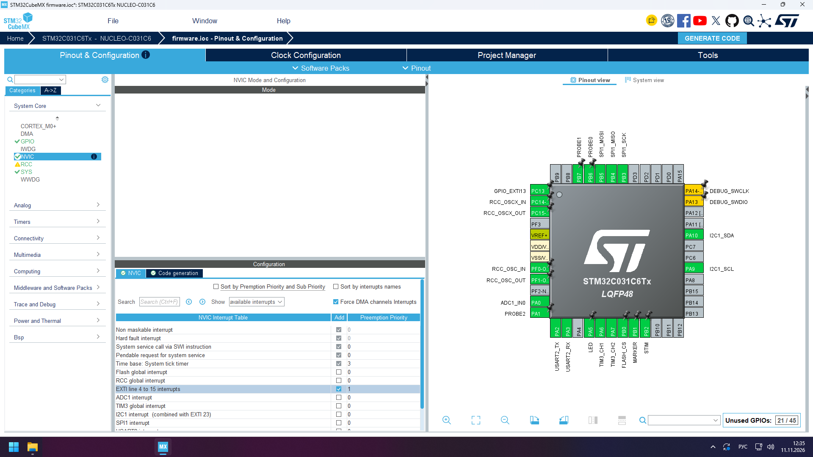
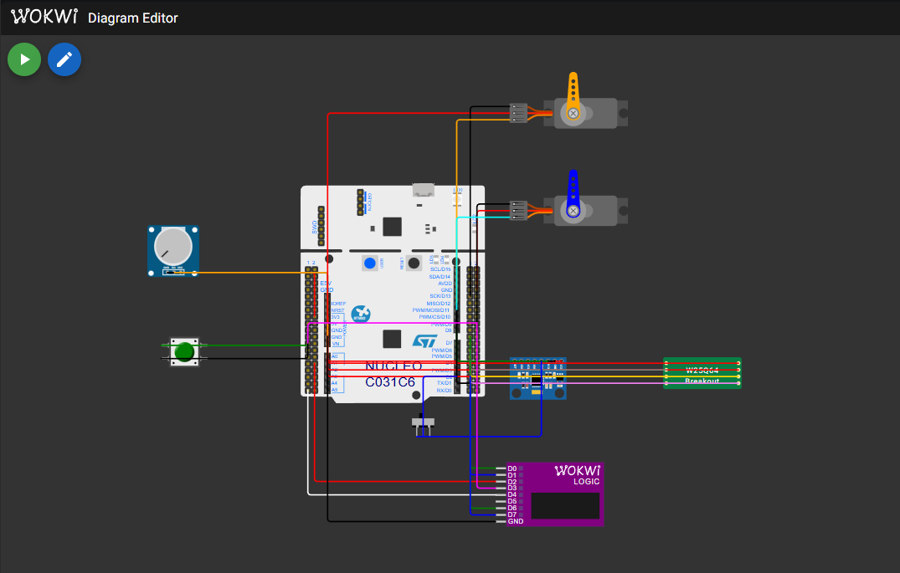
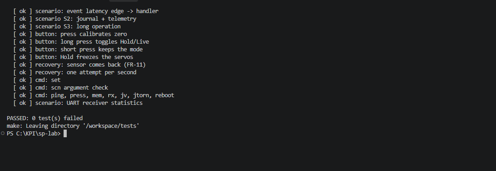
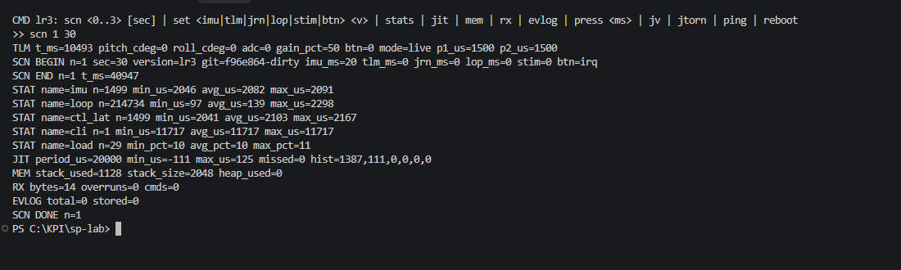
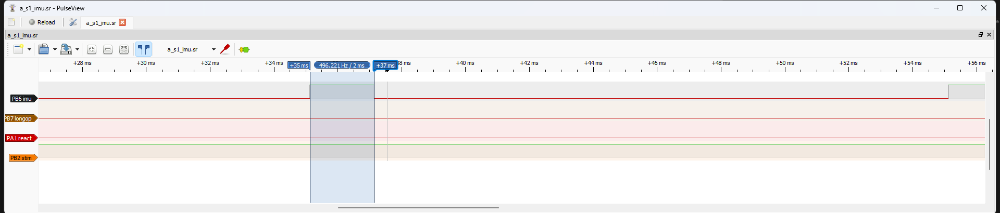
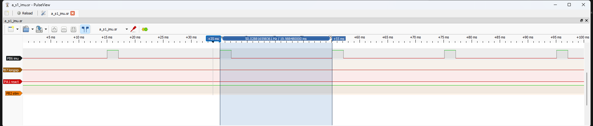
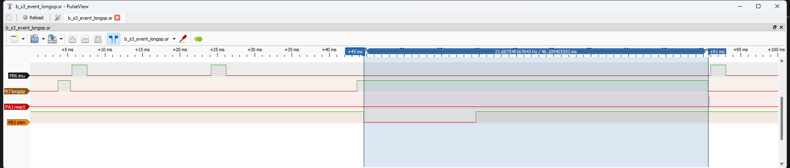
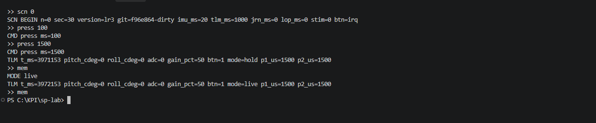

## Мета роботи

Зібрати прошивку Motion-Mirroring Teleoperator у вигляді головного циклу (super loop) на STM32C031C6, виміряти час виконання задач, джитер, затримку реакції на подію, завантаження CPU і пам'ять, знайти навантаження, за якого вимоги PRD порушуються, і зробити висновок, чи потрібна продукту ОС.

Форма B: фізичного стенда немає, прошивка працює у симуляторі Wokwi (VS Code). Тому всі числа – з симулятора. Абсолютний час стирання flash задає модель W25Q64, а не кристал, тож довіряти можна співвідношенням і збігу двох способів вимірювання, а не мілісекундам як таким. Які саме числа достовірні і як їх перевірити на залізі – у розд. 9.3.

## 1. Стан вимог

| FR | Вимога | Стан | Чим перевірено | Обмеження |
|---|---|---|---|---|
| FR-01 | `hello` < 1 с | виконано | `boot` ×5: перше повідомлення через 7 мс, самотест 146 мс, `READY` на 489 мс | – |
| FR-02 | виявлення MPU-6050 | виконано | самотест, `whoami` | – |
| FR-03 | опитування IMU ≥ 50 Гц | з обмеженням | S1: 0 пропусків; S2: 2; S3: 61 | LIM-1, LIM-2 |
| FR-04 | похибка кута ≤ 5° | виконано | хостові тести `motion` | – |
| FR-05 | сервоприводи 1000–2000 мкс / 20 мс | виконано | хостові тести, команда `pwm` | – |
| FR-06 | зміна → PWM < 50 мс | з обмеженням | S1 22,2 мс; S2 68,9 мс; S3 81,4 мс | LIM-2 |
| FR-07 | потенціометр керує амплітудою | виконано | команда `adc` | – |
| FR-08 | кнопка: центрування, режим | з обмеженням | `press 100` / `press 1500`; E1–E3; у S3 реакція до 58,7 мс | LIM-1 |
| FR-09 | LD4 за режимом | виконано | хостові тести | – |
| FR-10 | 10 ± 1 рядок телеметрії за 10 с | з обмеженням | S2 стабільно; у S3 телеметрія їсть до 26 % CPU; B_tlm | LIM-3 |
| FR-11 | відмова датчика: PWM 1500, повідомлення | виконано | сценарій F1, `recover` до 4,7 мс; хостові тести відновлення | LIM-5 |

«З обмеженням» означає: у S1 вимога виконується, у важчих режимах – ні. Це головний результат роботи. Вердикт «виконано» ставлю лише тоді, коли максимум у найгіршому сценарії не перевищує вимогу (методичка, п. 6.3). Статусу «недосяжна в цій архітектурі» немає: для кожного порушення в реєстрі (розд. 9) названо обхід без ОС, але я його не реалізовував і вимірюванням не перевіряв.

## 2. Будова прошивки

`main()` після ініціалізації та самотесту крутить `while (1) { app_poll(); }`. Кожна задача сама дивиться на лічильник часу і, якщо ще не її черга, одразу повертає керування. Порядок викликів у `app_poll()`: `cli` → `event` → `imu` → `led` → `tlm` → `jrn` → `lop` → `recover` → вікно навантаження → перевірка завершення сценарію.


### 2.1 Задачі, періоди і дедлайни

Повний перелік – у `docs/tasks.md`. PRD дає числа не для всіх задач, тому там, де їх немає, введено похідні вимоги DR-1 і DR-2 (позначені явно), щоб було з чим порівнювати вимірювання.

| Задача | Що запускає | Період / подія | Дедлайн | Вимоги | Пін / лічильник |
|---|---|---|---|---|---|
| `imu` (MPU-6050, фільтр, PWM) | мітка часу | 20 мс | наступний запуск ≤ 20 мс (FR-03); DR-1: інтервал ≤ 40 мс | FR-03…05 | PB6; `STAT imu`, `JIT` |
| `ctl_lat` | складова `imu` | кожен запуск `imu` | < 50 мс | FR-06 | `STAT ctl_lat` |
| `event` (кнопка) | EXTI4_15 (PC13) або опитування | 0,4–1,5 с у S2; 40–240 мс у S3 | DR-2: фронт → початок обробки ≤ 50 мс | FR-08 | PB2 → PA1; `STAT ev_lat`, `EVT` |
| `led` (LD4) | мітка часу | 500 мс (Live), 100 мс (помилка) | ± 100 мс на фазу | FR-09 | – |
| `tlm` (рядок у UART) | мітка часу | 1 с у S2; 200 мс у S3 | 10 ± 1 рядок за 10 с | FR-10 | `STAT telemetry` |
| `jrn` (журнал у flash, CRC-16) | мітка часу | 500 мс у S2; 100 мс у S3 | запис не губиться, журнал цілий | похідна від FR-10 | `STAT journal`, `jv` |
| `lop` (стирання сектора + запис сторінки) | мітка часу | 1 с у S3 | – (це навантаження) | – | PB7; `STAT longop` |
| `recover` (повторне виявлення датчика) | мітка часу | 1 с, лише в режимі помилки | відновлення ≤ 2 с | FR-11 | `STAT recover` |
| `cli` (розбір команди) | байт у USART2 (опитування) | довільно | відповідь на `ping` без втрат | – | `STAT cli`, `RX` |

### 2.2 Переривання і спільні дані

Використано два переривання. SysTick дає мілісекундний тік HAL і відлік для лічильника циклів. EXTI4_15 (пріоритет 1) обробляє кнопку PC13: ISR займає 8 мкс (`STAT ev_irq`), лише записує мітку фронту і мітку входу в ISR у чергу `g_evq` на 16 елементів, а реакцію виконує цикл. Прийом USART2 і транзакції I²C та SPI працюють опитуванням у циклі, передача в UART блокувальна (`HAL_UART_Transmit`). Це свідомий вибір: саме він породжує LIM-3, LIM-4 і LIM-5.

Спільні між ISR і циклом дані – лише черга подій (`g_evq`, `g_ev_head` пише ISR, `g_ev_tail` – цикл, `g_ev_dropped` рахує втрати при переповненні) і мітка останнього фронту; всі вони `volatile`, у кільці спочатку записуються дані, потім індекс. В ISR немає `printf`, flash і викликів HAL із timeout.

Кнопка PC13 працює через EXTI4_15 (у CubeMX увімкнено лінію переривання та NVIC), стимул для тестів – перемичка PB2 → PC13. Для режиму «опитування» лінія знімається через `HAL_GPIO_DeInit`.




Схема в Wokwi: до плати NUCLEO-C031C6 підключено MPU-6050, W25Q64, два сервоприводи, потенціометр, кнопку і логічний аналізатор. Канали аналізатора: D0 = PB6 (вікно `imu`), D1 = PB7 (довга операція), D2 = PA1 (початок обробки події), D3 = PB2 (стимул).



Перевірки: `make test` проходить повністю (69 тестів з ЛР2 і 29 нових).



## 3. Як вимірював

1. Одна збірка, чотири набори налаштувань: S1, S2, S3 задаються командою `scn`, решта – командою `set`. Прогін робить `tools/run_scenarios.py`, команди друкуються по символу з паузою 20 мс (інакше термінал Wokwi губить байти).
2. Лічильник МК: у Cortex-M0+ немає DWT, тому лічильник циклів зроблено на SysTick. Для кожної задачі виводяться `n`, `min`, `avg`, `max` у мкс.
3. Логічний аналізатор: запис усієї сесії зберігається у `wokwi.vcd` після кнопки Stop, далі `sigrok-cli` перетворює його у `.sr`, а дивлюся у PulseView. Курсорами міряв інтервали.
4. Джитер = фактичний інтервал між запусками `imu` мінус 20 мс. Інтервал ≥ 30 мс вважаю пропуском.
5. Затримка події = від фронту PB2 до фронту PA1.
6. Пам'ять: `--print-memory-usage`, `size -A`, `nm --size-sort`, stack painting для стека.
7. Час беру з лічильника МК, а не з часу приходу рядка на хості; у першому рядку кожного логу (`SCN BEGIN`) є версія збірки і git-хеш.

### 3.1 Умови, однакові для всіх прогонів

| Параметр | Значення |
|---|---|
| Платформа | NUCLEO-C031C6 (Cortex-M0+), форма B – Wokwi у VS Code |
| Тактова частота | 48 МГц (HSI48) |
| Збірка | `-Os -flto`, `-Wall -Wextra -Wshadow -Wpedantic -Werror` для власного коду |
| UART | USART2, 115200 8N1 |
| Лічильник часу | SysTick, 32 біти, переповнення через 89 с |
| Аналізатор | D0 = PB6, D1 = PB7, D2 = PA1, D3 = PB2 |
| Стимул кнопки | PB2 → PC13, генератор xorshift32 з фіксованим зерном, натискання 15 мс |
| Тривалість | S1–S3, E, U, F, J: 20–40 с; B_*: 10 с; довгий S2: 3600 с |

### 3.2 Сценарії

| Сценарій | `imu` | `tlm` | `jrn` | `lop` | Кнопка | Опис |
|---|---|---|---|---|---|---|
| S1 – простій | 20 мс | вимк. | вимк. | вимк. | немає | лише періодична задача керування |
| S2 – номінальний | 20 мс | 1 с | 500 мс | вимк. | рідкісна (0,4–1,5 с) | режим із PRD |
| S3 – найгірший | 20 мс | 200 мс | 100 мс | 1 с | часта (40–240 мс) | усе одразу: довга операція, журнал, телеметрія, потік подій |

Сценарії з розділу 6.2 методички і прогони, які їх закривають:

| П. 6.2 | Що перевіряє | Прогін | Де в звіті |
|---|---|---|---|
| 1 | довга операція + періодична | L1_baseline, L1_flash | розд. 6 |
| 2 | подія під час довгої операції (30–50 разів) | E1, E2, E3; S3 (214 / 211 подій) | розд. 4, 5, 6 |
| 3 | потік команд UART | U1, U2 | розд. 6 |
| 4 | відмова датчика | F1 | розд. 6 |
| 5 | пошук точки зламу | B_imu, B_tlm, B_lop | розд. 6 |
| 6 | тривала робота (1 година) | `long 3600` | розд. 6 |
| 7 | старт і перезапуск | `boot` ×5 | розд. 6 |
| 8 | цілісність журналу | J1 (`jtorn`) | розд. 6 |

## 4. Результати S1, S2, S3

| Метрика | S1 | S2 | S3 | Вимога | Спосіб виміру | Вердикт |
|---|---|---|---|---|---|---|
| `imu`, avg / max | 2,08 / 2,09 мс | 2,08 / 2,12 мс | 2,08 / 2,17 мс | – | лічильник; аналізатор PB6: 2,02 мс | – |
| Max інтервал між запусками `imu` | 20,1 мс | 66,8 мс | 79,3 мс | ≤ 20 мс (FR-03); DR-1 ≤ 40 мс | лічильник; аналізатор (S3) | S1 виконана; S2, S3 ні |
| Пропущено періодів | 0 | 2 | 61 | 0 | лічильник (`JIT`) | S1 так; S2, S3 ні |
| FR-06, найгірший випадок | 22,2 мс | 68,9 мс | 81,4 мс | < 50 мс | max інтервал + 2,1 мс обробки | S1 так; S2, S3 ні |
| Затримка події, max | – | 1,98 мс | 46,5 / 58,7 мс | ≤ 50 мс (DR-2) | лічильник + аналізатор | S2 так; S3 ні (58,7 > 50) |
| Затримка події, p50 / p99 | – | 0,12 / 1,98 мс | 0,16 / 37,6 мс | – | лічильник, журнал `EVLOG` | – |
| CPU, avg / max | 10 / 11 % | 12 / 16 % | 22 / 26 % | – | лічильник (`STAT load`) | – |
| Max затримка циклу `loop` | 2,30 мс | 47,4 мс | 59,7 мс | – | лічильник | – |
| Стек | 1128 Б | 1128 Б | 1112 Б | резерв 2048 Б | stack painting | так, запас 920 Б |
| Heap | 0 | 0 | 0 | – | `_sbrk(0) − &_end` | – |

Для S3 зроблено два прогони, тому два значення затримки події; різниця залежить від того, як натискання потрапили відносно стирання flash. Для вердикту беру більше. Різниця S3 − S1 – це ціна навантаження: максимальний інтервал між запусками `imu` зростає з 20,1 до 79,3 мс (майже в 4 рази), хоча середня тривалість самої задачі не змінюється (2,08 мс).

Вивід прошивки для S1 (близько 10 % CPU, джитер ±0,12 мс, пропусків немає):



І для S3 (джитер до 59 мс, 61 пропуск, завантаження 22 %):


Цікаво, що середнє завантаження S3 всього 22 %, а вимоги все одно порушено. Справа не в сумі, а в найдовшій задачі, яку не можна перервати: стирання сектора блокує цикл на ≈ 47 мс.

### 4.1 Час виконання кожної задачі

Одиниця – мкс, формат min / avg / max, у дужках кількість вимірів. «–» означає, що задача в цьому сценарії вимкнена.

| Задача | S1 | S2 | S3 |
|---|---|---|---|
| `imu` | 2046 / 2082 / 2091 (1499) | 2044 / 2080 / 2116 (1497) | 2045 / 2081 / 2167 (1438) |
| `ctl_lat` | 2041 / 2103 / 2167 (1499) | 2035 / 2337 / 14139 (1497) | 2034 / 3542 / 21442 (1438) |
| `loop` (період циклу) | 97 / 139 / 2298 | 103 / 147 / 47409 | 106 / 170 / 59676 |
| `ev_irq` (ISR кнопки) | – | 8 / 8 / 8 (27) | 7 / 8 / 8 (214) |
| `ev_lat` (затримка події) | – | 69 / 340 / 1982 (27) | 66 / 2531 / 58650 (214) |
| `telemetry` | – | 10621 / 10629 / 10648 (29) | 10606 / 10628 / 10710 (149) |
| `journal` | – | 1674 / 2451 / 47209 (59) | 1672 / 1984 / 47270 (299) |
| `longop` (`lop`) | – | – | 46842 / 46931 / 46977 (29) |
| `load`, % | 10 / 10 / 11 | 12 / 12 / 16 | 22 / 22 / 26 |

Найдовші блокувальні виклики: стирання сектора (`longop` і запис журналу, коли в ньому стирається сектор) ≈ 47 мс і рядок телеметрії ≈ 10,6 мс. Саме вони, а не `imu` (2 мс), визначають максимум циклу.

### 4.2 Гістограма джитеру `imu`

Модуль відхилення інтервалу від 20 мс за межами 100, 500, 1000, 5000, 20000 мкс; кількість інтервалів.

| Відхилення | S1 | S2 | S3 |
|---|---|---|---|
| ≤ 100 мкс | 1387 | 1204 | 1091 |
| ≤ 500 мкс | 111 | 232 | 15 |
| ≤ 1000 мкс | 0 | 0 | 0 |
| ≤ 5000 мкс | 0 | 0 | 29 |
| ≤ 20000 мкс | 0 | 59 | 271 |
| > 20000 мкс | 0 | 1 | 31 |
| min / max джитер | −111 / +125 мкс | −12,1 / +46,8 мс | −17,7 / +59,3 мс |

У S1 усе вкладається у 500 мкс. У S3 понад п'яту частину інтервалів (302 з 1437) відхиляється більш ніж на 5 мс.

## 5. Що показав аналізатор

У S1 вікно `imu` (PB6) має ширину 2 мс і йде з періодом 20 мс.





У S3 картина інша. Загальний вигляд двох секунд: імпульси `imu` рівні, поки немає довгих операцій, а на кожну довгу операцію PB7 (широкі прямокутники) припадає пропуск у PB6.


Один такий пропуск зблизька: між двома сусідніми імпульсами `imu` 67 мс замість 20.


Реакція на подію. Коли цикл вільний, PA1 піднімається приблизно через 136 мкс після фронту PB2:


А якщо кнопку натиснуто під час стирання, PA1 піднімається лише коли PB7 опускається, тобто через 46 мс:



Різниця більше ніж у 300 разів, і це та сама подія та сама прошивка.

## 6. Інші сценарії

**Довга операція + періодична (L1, 20 с).**

| Метрика | L1_baseline | L1_flash (стирання щосекунди) |
|---|---|---|
| Запусків `imu` | 999 | 961 |
| Max джитер | 118 мкс | 46,5 мс |
| Пропущено періодів | 0 | 38 |
| Max затримка циклу | 2,30 мс | 47,16 мс |

**Подія під час довгої операції (E1–E3, 36–41 подія на прогін).**

| | E1: EXTI, цикл вільний | E2: EXTI, `lop` 500 мс | E3: опитування, `lop` 500 мс |
|---|---|---|---|
| Подій | 41 | 37 | 36 з 37 |
| p50 затримки | 0,15 мс | 0,15 мс | 0,15 мс |
| Max затримка | 1,73 мс | 40,2 мс | 1,56 мс |

У E3 максимум малий лише тому, що одне натискання потрапило у стирання і зникло. Опитування для продукту не підходить, а EXTI з чергою події зберігає, але швидше їх не обробляє.

**Потік команд UART (U1, U2).** Надіслано ≈ 7900 команд `ping`, оброблено 1051 (S2) і 844 (S3), тобто 11–13 %. Лічильник overrun показує 0, бо Wokwi не емулює прапор ORE, тому втрати встановлено за балансом надісланих і оброблених. У прошивці прапор ORE рахується (`uart_rx_stats`), тож на залізі втрату покаже лічильник.

**Відмова датчика (F1, 40 с).** Слайд-перемикач у лінії SDA розриває шину, потім через ≈ 10 с замикає. Прошивка переходить у `ERROR`, обидва PWM = 1500 мкс, виводиться повідомлення `ERROR mpu6050 lost, servos centred`, після повернення датчика режим відновлюється (`INFO mpu6050 recovered`). Невдала транзакція блокує цикл до 3,69 мс, спроба відновлення (`recover`) – до 4,67 мс, усього 12 спроб. У симуляторі розірваний SDA дає швидкий NACK; на залізі одна транзакція чекала б повного таймауту 20 мс (`BOARD_I2C_TIMEOUT_MS`), це оцінка за кодом, не вимір.

**Точки зламу (`B_*`).** Підвищував навантаження по одній осі, решту тримав як у S3 або вимикав. Таблиці за 10 с на прогін.

Частота опитування `imu` (тло S3):

| Період `imu` | Запусків за 10 с | Max джитер | Пропущено | CPU |
|---|---|---|---|---|
| 20 мс | 480 | 42,1 мс | 20 | 22 % |
| 10 мс | 914 | 59,4 мс | 85 | 31 % |
| 5 мс | 1811 | 59,6 мс | 188 | 50 % |
| 2 мс | 3943 | 47,5 мс | 1055 | 94 % |
| 1 мс | 3926 | 48,5 мс | 6072 | 94 % |

При періоді 1 мс ефективний період 2,55 мс (3926 запусків за 10 с): процесор насичено, 2 мс – перша точка, де CPU 94 %.

Частота телеметрії (`tlm`) без `lop`:

| Період `tlm` | CPU | Max джитер `imu` | Max затримка циклу |
|---|---|---|---|
| 100 мс | 21 % | 10,4 мс | 11,0 мс |
| 50 мс | 32 % | 10,8 мс | 13,1 мс |
| 20 мс | 64 % | 0,19 мс | 11,0 мс |
| 10 мс | 98 % | 4,1 мс | 13,2 мс |

Частота довгої операції (`lop`) без телеметрії:

| Період `lop` | Запусків `imu` за 10 с | Пропущено | CPU |
|---|---|---|---|
| 500 мс | 461 | 38 | 19 % |
| 200 мс | 401 | 98 | 32 % |
| 100 мс | 301 | 198 | 53 % |
| 60 мс | 167 | 330 | 81 % |

Телеметрія з періодом 10 мс займає 98 % процесора, а стирання кожні 60 мс залишає `imu` лише 167 запусків із 500 очікуваних (губиться ≈ 67 %). Це і є «межа, у яку вперлися».

**Година роботи (S2, 3600 с).** 179 581 запуск `imu`, стек 1128 Б і heap 0 не змінились, журнал цілий (`bad=0`) після 26 стирань сектора, 32-бітний лічильник близько 40 разів перетнув межу 89 с без збоїв. Великі максимуми в цьому прогоні (до 0,75 с) дає команда `jv`, яку я сам запускав кожні 5 хв: вона синхронна і блокує цикл.

**Старт і перезапуск (6.2-7).** П'ять перезапусків (`reboot`) дали ідентичні числа: перше повідомлення `hello` через 7 мс, початок самотесту 7 мс, кінець 146 мс (8 перевірок з 8), демо PWM закінчується на 389 мс, `READY` на 489 мс. Якщо датчика нема в момент ініціалізації, самотест друкує `FAIL`, прошивка стартує в режимі `ERROR` і раз на секунду намагається знайти датчик (`recover`); це перевірено хостовими тестами (`selftest: IMU missing`, `recovery: one attempt per second`, `sensor comes back`). У симуляторі сценарій «датчик підключено, але ще не готовий на старті» окремо не запускав – є лише розрив SDA посеред роботи (F1).

**Цілісність журналу (6.2-8, J1).** Журнал зберігає 16-байтові записи з CRC-16. Після прогону `jv` дає `good=625 bad=0`. Вимкнення живлення посеред запису симулятор не відтворює, тому обірваний запис імітує команда `jtorn` (записується лише частина запису): наступний `jv` дає `good=625 bad=1`, тобто CRC знаходить обірваний запис, а наступні записи не втрачаються.

Перевірка кнопки (FR-08): коротке натискання режим не змінює, довге перемикає Hold/Live.



## 7. Лічильник МК проти аналізатора

| Метрика | Лічильник МК | Аналізатор |
|---|---|---|
| Ширина вікна `imu` | 2082 мкс | 2020 мкс |
| Період `imu` у S1 | 20000 мкс (джитер −111 / +125 мкс) | 20000,4 мкс |
| Затримка події, S3, p50 | ≈ 159 мкс | 162,8 мкс |
| Затримка події, S3, max | 46,5 мс (один прогін), 58,7 мс (інший) | 46,2 мс |

Ширина вікна розходиться на 62 мкс (3 %): лічильник міряє від входу в задачу до виклику `perf_end`, пін піднімається вже всередині задачі. Решта збігається. Аналізатор у новому прогоні записав 194 події. Висновок: лічильнику можна вірити, поправка відома і мала.

### 7.1 Порівняння з розрахунком

| Величина | Розрахунок | Виміряно | Різниця | Пояснення |
|---|---|---|---|---|
| Рядок телеметрії, ≈ 98 символів при 115200 бод (10 біт на символ) | 8,5 мс | 10,6 мс (`STAT telemetry`) | +25 % | форматування `vsnprintf` на ядрі без апаратного ділення; окремо не вимірював, це гіпотеза |
| `longop`: стирання сектора 45 мс + запис сторінки ≈ 2 мс | ≈ 47 мс | 46,9 мс (`STAT longop`) | менше 1 % | 45 мс і 2 мс – значення самотесту (`erase_ms`, `prog_ms`), які задає модель W25Q64 |
| Період `imu` | 20 мс | 20,0004 мс (аналізатор) | 0,002 % | – |

Розбіжність понад 10–20 % є лише в телеметрії, і я її пояснив гіпотезою, а не вимірюванням.

## 8. Пам'ять

Вивід лінкера (`-Wl,--print-memory-usage`, LTO, `-Os`):

```
Memory region         Used Size  Region Size  %age Used
           FLASH:       29156 B        32 KB     88.98%
             RAM:        5128 B        12 KB     41.73%
```


| Секція | Розмір, Б | Куди |
|---|---|---|
| `.isr_vector` | 192 | flash |
| `.text` | 25 084 | flash |
| `.rodata` | 3 572 | flash |
| `.data` | 120 | flash і RAM |
| `.bss` | 2 448 | RAM |
| `._user_heap_stack` | 2 560 | RAM: стек 2048 + heap 512 (зарезервовано) |

RAM: 120 + 2448 + 2560 = 5128 Б. Запас: flash 3612 Б (11 %), RAM 7160 Б, стек 920 Б.

### 8.1 Розподіл за модулями

Збірка з LTO зливає весь код у `main`, тому за символами модулі не розділити. Для розподілу я скомпілював ті самі файли без LTO (`-Os`, ті самі прапори) і взяв `arm-none-eabi-size` для кожного `.o`. Це верхня оцінка: `--gc-sections` і LTO у фінальному образі викидають невикористане, особливо в HAL.

| Група | Flash, Б (text + data) | Статична RAM, Б (data + bss) |
|---|---|---|
| App (`app`, `journal`, `motion`, `perf`, `crc16`) | 10 776 | 1 576 |
| Devices (`mpu6050`, `w25q64`) | 1 211 | 0 |
| Platform (`platform`) | 2 332 | 324 |
| Core і startup (`main`, `it`, `msp`, `system`, `startup`, `syscalls`, `sysmem`) | 2 470 | 524 |
| HAL (`stm32c0xx_hal_*.o`) | 59 422 | 33 |

Фінальний образ 29 156 Б складається з власного коду, потрібних частин HAL і бібліотек: символи без вихідного файлу (libc, libgcc: `printf`, `__udivsi3`, `__divdi3`) займають ≈ 7,9 КБ flash. Найбільший власний споживач RAM – стан додатка `g_app` (1576 Б, включно з таблицями статистики).

### 8.2 Найбільші символи

| Flash | Розмір, Б | RAM | Розмір, Б |
|---|---|---|---|
| `main` (з LTO в нього вбудовано задачі) | 7460 | `g_app` | 1576 |
| `app_selftest` | 1056 | `huart2` | 148 |
| `MX_ADC1_Init` | 796 | `g_evq` (черга подій) | 128 |
| `_printf_i` (libc) | 648 | `g_ports` | 108 |
| `_svfprintf_r` (libc) | 572 | `hspi1`, `hadc1` | 100 |
| `_svfiprintf_r` (libc) | 572 | `impure_data` (libc) | 96 |
| `MX_TIM3_Init` | 560 | `hi2c1` | 84 |

### 8.3 Стек і heap

З `--print-memory-usage` (LTO, `-Os`): FLASH 29 156 Б із 32 КБ (88,98 %), RAM 5128 Б із 12 КБ (41,73 %). `.data` 120 Б, `.bss` 2448 Б, під стек зарезервовано 2 КБ. Без LTO прошивка не влазить (104 %). Вільно 3,6 КБ flash – це обмеження для ЛР4: ядро RTOS тут не вміститься без викидання діагностики.

Стек: статична оцінка (`-fstack-usage`) для найглибшого шляху `app_poll` (128 Б) → `app_handle_line` (160 Б) → `emit` (176 Б) = 464 Б без бібліотечних викликів, виміряно stack painting 1128 Б (S1, S2) і 1112 Б (S3). Виміряне більше, бо статика не бачить викликів через вказівники (таблиця команд), `vsnprintf`/`_write` з libc і ISR поверх `printf`; окремо цю частину (≈ 660 Б) не вимірював, це оцінка за різницею. Перша спроба з резервом 1 КБ показала насичення на 1024 Б: справжні 1128 Б виходили за резерв. Heap: динамічної пам'яті немає (`heap_used = 0`, `malloc` не викликається), зарезервовані 512 Б не зайняті. Буфери: черга подій 16 × 8 = 128 Б, стан додатка 1576 Б.

## 9. Реєстр обмежень

Реєстр складається з семи обмежень, з якими я реально зіткнувся. Подробиці, таблиці і формулювання – у `docs/limitations.md`; тут кожне записано в тому ж форматі коротко.

| № | Категорія | Обмеження | Страждає | Доказ |
|---|---|---|---|---|
| LIM-1 | час реакції | Реакція на подію = найдовша задача циклу | FR-08 | 46–59 мс проти 0,16 мс у вільному циклі |
| LIM-2 | джитер, довга операція | Довга операція руйнує періодичність `imu` | FR-03, FR-06 | 38 пропусків у L1, 61 у S3 |
| LIM-3 | довга операція | Блокувальна телеметрія | FR-10 | `tlm` 10 мс: 98 % CPU |
| LIM-4 | спільні ресурси, втрата даних | Втрата байтів UART | команди | оброблено 11–13 % команд |
| LIM-5 | відмови | Відмова датчика блокує цикл на timeout | FR-11 | `recover` до 4,7 мс (20 мс за кодом) |
| LIM-6 | модульність | Нова задача зачіпає код у багатьох місцях | – | `lop`: 22 рядки в `app.c` |
| LIM-7 | пам'ять | Один стек на все | – | 1128 Б при резерві 1024 Б |

### 9.1 Записи реєстру

**LIM-1. Найгірша затримка реакції дорівнює найдовшій задачі в циклі.**

- **Симптом:** кнопка (FR-08) обробляється вчасно, коли цикл вільний, і з затримкою до десятків мілісекунд під час стирання сектора.
- **Доказ:** E1 max 1,73 мс, E2 max 40,2 мс, S3 max 58,7 / 46,5 мс (розд. 6); на аналізаторі інтервал PB2 → PA1 48,7 мс, поки PB7 високий (рис. 12, 13).
- **Причина в архітектурі:** подію перевіряють лише коли керування повертається в `app_poll()`: T_max = найдовша блокувальна задача (стирання 46,9 мс) + хвіст циклу + час до початку обробки. EXTI лише фіксує фронт і кладе в чергу.
- **Без ОС:** розбити стирання на кроки (машина станів із перевіркою BUSY у кожному проході) або виконати критичну реакцію прямо в ISR. Ціна: ≈ 40–60 рядків у `lop_task`, `volatile`-дані і критичні секції.
- **Що дасть ОС:** високопріоритетна задача кнопки витісняє стирання у будь-якій точці, затримка визначається перемиканням контексту.
- **Ціна ОС:** RAM під стек кожної задачі і ядро, перемикання контексту, інверсія пріоритетів на спільній шині SPI. На 32 КБ flash збірка вже займає 88,98 %.
- **Гіпотеза для ЛР4:** max затримка події в S3 впаде з 46–59 мс до значення менше 1 мс.

**LIM-2. Блокувальна довга операція руйнує періодичність керування.**

- **Симптом:** сервоприводи оновлюються нерівномірно, поки йде запис у flash; частина відліків IMU пропущена (FR-03, FR-06).
- **Доказ:** L1_flash: джитер 46,5 мс, 38 пропусків проти 118 мкс і 0 у L1_baseline; max інтервал IMU 20,1 / 66,8 / 79,3 мс у S1 / S2 / S3; FR-06 виконується лише в S1.
- **Причина в архітектурі:** задачі виконуються до завершення, одна за одною, без витіснення; час стирання (46,9 мс, у datasheet W25Q64 типово 45 мс, максимум 400 мс) додається до періоду будь-якої іншої задачі.
- **Без ОС:** запис і стирання машиною станів між відліками IMU або оновлення PWM у таймерному перериванні. Ціна: складніша логіка запису (стани, повтор при помилці), спільні дані між ISR і циклом.
- **Що дасть ОС:** стирання виконує задача з низьким пріоритетом, керування – з високим.
- **Ціна ОС:** мютекс на SPI-шину (інакше драйвер flash розривається витісненням), стек на задачу, накладні витрати планувальника (SysTick щомілісекунди).
- **Гіпотеза для ЛР4:** max джитер IMU в L1_flash впаде з 46,5 мс до 100–300 мкс, пропусків 0.

**LIM-3. Блокувальний вивід у UART обмежує частоту телеметрії.**

- **Симптом:** чим частіша телеметрія, тим менше часу лишається решті задач (FR-10).
- **Доказ:** B_tlm: CPU 21 / 32 / 64 / 98 % для періодів 100 / 50 / 20 / 10 мс; рядок ≈ 98 символів передається за 10,6 мс (розрахунок 8,5 мс, розд. 7.1).
- **Причина в архітектурі:** `HAL_UART_Transmit` блокує цикл на весь час передачі, змінити це в межах super loop можна лише переходом на передачу через переривання або DMA.
- **Без ОС:** кільцевий буфер і передача по TX-перериванню або DMA. Ціна: буфер ≈ 256 Б, політика при переповненні, `volatile`-індекси.
- **Що дасть ОС:** окрема задача виводу з чергою повідомлень; блокується лише вона.
- **Ціна ОС:** черга (RAM), стек задачі ≥ 1 КБ під `vsnprintf`, ризик глухого кута при виводі з кількох задач без мютекса.
- **Гіпотеза для ЛР4:** CPU при `tlm` 10 мс впаде з 98 % до 15–25 %.

**LIM-4. Приймач UART губить байти, коли цикл зайнятий.**

- **Симптом:** під час потоку команд частина команд спотворена (`CMD error unknown command`) або не доходить; лічильник ORE у симуляторі цього не показує.
- **Доказ:** U1 / U2: надіслано 7920 / 7960 `ping`, виконано 1051 / 844; хост надсилав ≈ 39 600–39 800 байтів, МК прийняв 7850 / 15 098.
- **Причина в архітектурі:** приймач опитується з циклу (`uart_read_char`), а регістр даних USART має глибину 1 байт; усе, що приходить за час стирання (≈ 47 мс), перезаписується.
- **Без ОС:** прийом у ISR (RXNE) з кільцевим буфером або DMA. Ціна: буфер 128–256 Б і спільні індекси.
- **Що дасть ОС:** лише чергу для задачі розбору; ISR і буфер потрібні й там, тобто ОС сама цього не розв'язує.
- **Ціна ОС:** те саме, що й без ОС, плюс стек задачі CLI.
- **Гіпотеза для ЛР4:** з приймачем на DMA або черзі втрат у U1/U2 не буде при будь-якій архітектурі (різниця «надіслано – прийнято» = 0).

**LIM-5. Втрата датчика блокує цикл на timeout.**

- **Симптом:** коли MPU-6050 не відповідає, задача IMU зупиняється, сервоприводи йдуть у центр (FR-11), відновлення раз на секунду.
- **Доказ:** F1: невдала транзакція до 3,69 мс, спроба відновлення до 4,67 мс, 12 спроб; на залізі за кодом 20 мс на спробу (`BOARD_I2C_TIMEOUT_MS`), не виміряно.
- **Причина в архітектурі:** виклик шини синхронний і виконується в тому самому потоці; тайм-аут задає драйвер, а не задача.
- **Без ОС:** драйвер I²C на перериваннях або DMA зі станом «транзакція в процесі» і тайм-аутом за таймером. Ціна: стан транзакції і повторні входи в драйвер.
- **Що дасть ОС:** блокування задачі з таймаутом: задача IMU «спить», решта працює.
- **Ціна ОС:** драйвер із семафором і режимом IT/DMA усе одно потрібен; ризик взаємного блокування, якщо два драйвери чекають одну шину.
- **Гіпотеза для ЛР4:** час, коли інші задачі не виконуються при втраті датчика, впаде з ≈ 4,7 мс (симулятор) / 20 мс (залізо, оцінка) до часу початку транзакції.

**LIM-6. Нова задача зі своїм періодом змінює код у багатьох місцях.**

- **Симптом:** щоб додати довгу операцію `lop`, довелося правити `app.c` у десяти місцях.
- **Доказ:** слово `lop` зустрічається у 22 рядках `firmware/App/app.c`: поле конфігурації, рядки таблиці сценаріїв, стан `next_lop_ms`, ідентифікатор і ім'я статистики, сама задача, виклик в `app_poll()`, ініціалізація, банер `SCN BEGIN`, команда `set`, друк `STAT`.
- **Причина в архітектурі:** розклад – не дані, а порядок викликів у циклі, а нова задача змінює вплив усіх інших; загального визначення «задача, її період, її дедлайн» немає.
- **Без ОС:** кооперативний планувальник із таблицею задач (≈ 100–200 Б flash). Порядок і дедлайни все одно треба перевіряти вимірюванням.
- **Що дасть ОС:** декларативне створення задачі (`xTaskCreate`) з періодом і пріоритетом.
- **Ціна ОС:** те саме, що й таблиця, плюс стек ≥ 0,5 КБ і контроль переповнення стеків.
- **Гіпотеза для ЛР4:** кількість місць у коді при додаванні задачі зменшиться з ≈ 10 до 1–2; швидкодія майже не зміниться, це вигода у підтримуваності.

**LIM-7. Один спільний стек для найгіршого ланцюжка викликів і ISR.**

- **Симптом:** зарезервований стек 1 КБ (значення CubeMX) виявився замалим.
- **Доказ:** stack painting: 1128 Б при резерві 1024 Б (насичення, `S1_stack1k.log`); після збільшення резерву до 2048 Б – 1128 Б із запасом 920 Б. Статична оцінка ланцюжка 464 Б, решта ≈ 660 Б – libc і HAL (за різницею).
- **Причина в архітектурі:** вся програма працює на одному стеку, його розмір має покривати найглибший ланцюжок (команда → форматування → UART) плюс вкладені ISR (SysTick → EXTI4_15).
- **Без ОС:** міряти стек після кожної зміни, зменшувати локальні буфери (`emit` тримає 176 Б), відмовитися від `vsnprintf`.
- **Що дасть ОС:** нічого щодо глибини, кожна задача потребує свого стека.
- **Ціна ОС:** стек на задачу (≥ 0,5–1 КБ) × число задач = 4–5 КБ із 12 КБ RAM, ризик переповнення стека окремої задачі.
- **Гіпотеза для ЛР4:** RAM під стеки зросте в 3–5 разів порівняно з 1,1 КБ у super loop.

### 9.2 Що super loop робить краще, ніж зробила б ОС

Це треба перевірити в ЛР4, щоб не втратити.

- Детермінізм у простому режимі: у S1 джитер IMU −111…+125 мкс, нічого не пропущено, затримка циклу ≤ 2,3 мс без планувальника.
- Мінімум пам'яті: FLASH 29 156 Б (88,98 %), RAM 5128 Б, з них `.data` + `.bss` лише 2568 Б; ядро RTOS додало б власний стек і структури кожної задачі.
- Час старту: 7 мс до першого повідомлення, самотест на 146 мс, `READY` на 489 мс; у п'яти перезапусках підряд числа збігаються до мілісекунди.
- Простота налагодження: один стек, один потік, відтворювані послідовності (стимул із фіксованим зерном); єдині спільні з ISR дані – черга подій, лічильники UART і час фронту.
- Прозорість розкладу: порядок задач видно прямо в `app_poll()`, немає прихованого витіснення і класу помилок «задачу перервали в неправильному місці».

### 9.3 Достовірність чисел (форма B) і перевірка на залізі

Симулятор не відтворює точні часові характеристики кристала (методичка, п. 2.2), тому кожне число з Wokwi треба оцінювати окремо.

| Число | Довіряю | Чому | Як перевірити на залізі |
|---|---|---|---|
| Відносні величини: S3 − S1, EXTI проти опитування, співвідношення затримок | так | не залежать від абсолютних часів моделі | повторити S1–S3 тим самим скриптом на платі |
| Збіг лічильника МК і аналізатора (3,4–4,5 мкс; 46,5 і 46,2 мс) | так | два незалежні способи в одній симуляції | ті самі піни PB6, PB7, PA1 і реальний аналізатор |
| Час стирання сектора 46,9 мс | ні (абсолютно) | задає власна модель W25Q64 (45 мс), на кристалі 45–400 мс | аналізатор на CS: тривалість BUSY; LIM-1 і LIM-2 на кристалі гірші |
| Втрати UART, `overruns = 0` | частково | Wokwi не виставляє ORE, хост шле пакети швидше за бодову швидкість | лічильник ORE, потік команд з реального USB-UART |
| Тайм-аут датчика 4,7 мс | ні | розірваний SDA у Wokwi дає швидкий NACK, на залізі 20 мс за кодом | затиснути SDA на землю, виміряти `STAT imu` і PB6 |
| Час транзакцій I²C і SPI | наближено | модель I²C неточна (повторний START, скидання PE) | аналізатор на SDA/SCL; `BOARD_I2C_REPEATED_START = 1` |

## 10. Проблеми, які були

| № | Симптом | Причина | Виправлення |
|---|---|---|---|
| 1 | Стек «упирався» у 1024 Б | stack painting малювався лише в межах резерву, справжня глибина 1128 Б | малювання від `_end`, резерв 2 КБ: [2bda0a5](https://github.com/Zenzoik/lab-1-sprg/commit/2bda0a5), [0c132cc](https://github.com/Zenzoik/lab-1-sprg/commit/0c132cc) |
| 2 | У режимі опитування кнопка давала дві події | `HAL_GPIO_Init` не знімає EXTI | `HAL_GPIO_DeInit` перед повторною ініціалізацією: [2bda0a5](https://github.com/Zenzoik/lab-1-sprg/commit/2bda0a5) |
| 3 | Команди губилися або `unknown command` | термінал Wokwi губить байти пакета і хоче `\r` | друк по символу з паузою 20 мс: [e8e015a](https://github.com/Zenzoik/lab-1-sprg/commit/e8e015a) |
| 4 | `region FLASH overflowed`, 104 % | без LTO не влазить у 32 КБ | `-flto -Os` → 88,98 %: [0c132cc](https://github.com/Zenzoik/lab-1-sprg/commit/0c132cc); для стека окремий `stack_static.sh`: [e8e015a](https://github.com/Zenzoik/lab-1-sprg/commit/e8e015a) |
| 5 | Запис аналізатора обривався на ≈ 33 мс | обмежений буфер тригерного режиму | запис усієї сесії через Stop, фрагмент вирізає скрипт: [e8e015a](https://github.com/Zenzoik/lab-1-sprg/commit/e8e015a) |
| 6 | У S3 `ctl_lat` 21 мс при інтервалі між відліками 79 мс | `ctl_lat` не враховує пропущені відліки | рахую пропуски окремо (`imu_missed`), для FR-06 беру max інтервал + 2,1 мс: [2bda0a5](https://github.com/Zenzoik/lab-1-sprg/commit/2bda0a5) |
| 7 | Довгий прогін S2 раптом обривався | перезбірка ELF перезапускає симулятор | режим `long` у `run_scenarios.py`, перезбираю тільки між прогонами: [e8e015a](https://github.com/Zenzoik/lab-1-sprg/commit/e8e015a) |

## 11. Базова лінія для ЛР4

Окремий документ – `docs/baseline-lab4.md`. У ньому: умови вимірювань, перелік сценаріїв з командами для відтворення, таблиця фінальних метрик, гіпотези з реєстру і опис вимірювального інструментарію, який у ЛР4 буде використано без змін. Тут – зведення.

| № | Обмеження | Метрика для порівняння | Очікування для RTOS |
|---|---|---|---|
| 1 | Реакція = найдовша задача | max затримки події в S3 / E2 | з 46–59 мс до < 1 мс |
| 2 | Довга операція руйнує періодичність | max джитер IMU у L1_flash | з 46,5 мс до 0,1–0,3 мс, пропусків 0 |
| 3 | Блокувальний UART TX | CPU при `tlm` = 10 мс | з 98 % до 15–25 % |
| 4 | Втрата байтів приймача | «надіслано − прийнято» в U1 / U2 | 0 (вирішують переривання або DMA, а не ОС) |
| 5 | Відмова датчика блокує цикл | час, коли інші задачі не виконуються | з ≈ 4,7 мс / 20 мс до часу початку транзакції |
| 6 | Нова задача змінює код у багатьох місцях | число місць у коді | з ≈ 10 до 1–2 |
| 7 | Спільний стек | RAM під стеки | зросте в 3–5 разів |

Опорні числа super loop для ЛР4: S3 max інтервал IMU 79,3 мс; затримка події max 58,7 мс (p99 37,6 мс); пропущено 61 період; CPU 22 / 26 %; стек 1112 Б; FLASH 29 156 Б, RAM 5128 Б.

Відтворення (у WSL Ubuntu, з теки репозиторію): `make image` – образ тулчейна; `make build` – прошивка; `make test` – хостові тести; `make check` – залежності шарів і розпіновка; симулятор Wokwi запускається з VS Code (`Wokwi: Start Simulator`), далі `python tools/run_scenarios.py run S3` (усі сценарії – у `docs/baseline-lab4.md`). Сирі логи – `docs/metrics/`, записи аналізатора – `docs/captures/`.

Збірка, з якої отримано числа, має у банері `git=f96e864-dirty`: це робоче дерево поверх останнього коміту ЛР2, а не окремий коміт реалізації. SHA256 збереженого `firmware/build/firmware.elf`: `cb2e3e99b6dbec1a827c3f5a79ded51069e800dfc66f3e85c7ee68873589d94a`. Фінальний коміт позначено тегом `lab3`. Репозиторій: [Zenzoik/lab-1-sprg](https://github.com/Zenzoik/lab-1-sprg), гілка `lab3`. Відео захисту: [Google Drive](https://drive.google.com/file/d/1BKN4Hr1MUvasH2crQekjl7kvph6BiGfn/view?usp=sharing).

## 12. Висновок

Для S1 super loop цілком достатній: інтервал 20,1 мс, FR-06 22,2 мс, CPU 10 %. У S2 ламається лише FR-06 у найгіршому випадку (68,9 мс) через запис журналу. У S3 super loop не тримає FR-03, FR-06 і реакцію на кнопку, хоча CPU завантажений лише на 22 %. Причина – неперервні блокувальні задачі (стирання flash ≈ 47 мс, телеметрія, журнал), які цикл перервати не може.

Якщо продукт має одночасно вести журнал у flash і тримати 50 Гц, потрібне витіснення: RTOS або принаймні розбиття довгих операцій на кроки. LIM-1, 2, 3 і 5 вирішуються пріоритетами й чергами, LIM-4 – DMA. Ціна: вільних 3,6 КБ flash замало, а стеки задач збільшать RAM у 3–5 разів. Тому ЛР4 починається з бюджету пам'яті (`docs/baseline-lab4.md`). Водночас super loop у цьому продукті виграє у детермінізмі в простому режимі, розмірі і часі старту (розд. 9.2); у ЛР4 це треба перевірити, щоб не втратити.

Усі числа отримано в симуляторі. Відносні величини і збіг двох способів вимірювання я вважаю достовірними, абсолютні часи стирання, тайм-аут шини і втрати UART – ні, і для них у розд. 9.3 описано перевірку на залізі.

## 13. Внесок

Форма B, робота індивідуальна, усі п'ять ролей з розділу 9 методички виконав Зернишкін І. Д. Історія – у `git log` гілки `lab3`.

| № | Роль | Відповідальний | Артефакти |
|---|---|---|---|
| 1 | Розробка super loop | Зернишкін І. Д. | `firmware/App`, `firmware/Platform`, `firmware/Devices`, `docs/tasks.md`, діаграма циклу |
| 2 | Метрики | Зернишкін І. Д. | `perf.c/.h`, формат `STAT`/`JIT`/`MEM`, `tools/lr3_vcd.py`, `tools/run_scenarios.py`, `tools/stack_static.sh` |
| 3 | Тестування | Зернишкін І. Д. | сценарії, `docs/metrics/results.json`, таблиці і вердикти по FR, `tests/test_lr3.c` (29 тестів) |
| 4 | Тестування на обладнанні (у симуляторі) | Зернишкін І. Д. | записи аналізатора `docs/captures/`, логи `docs/metrics/`, відмова SDA слайд-перемикачем |
| 5 | Звіт | Зернишкін І. Д. | `docs/limitations.md`, `docs/baseline-lab4.md`, цей звіт |

## 14. Відповіді на контрольні питання

1. **Головний цикл.** `while (1) { app_poll(); }`, у `app_poll` задачі `cli → event → imu → led → tlm → jrn → lop → recover → load`. Найгірша затримка реакції T_resp = T_longest + T_isr + T_event. У нас T_longest ≈ 47 мс (стирання), T_event ≈ 0,16 мс, виміряно max 46,5–58,7 мс.
2. **Джитер** – відхилення фактичного інтервалу між запусками періодичної задачі від періоду. У S1 −111/+125 мкс, у S3 до 59 мс, через стирання flash і телеметрію.
3. **Найгірший час, а не середній.** Середнє CPU в S3 22 %, але інтервал до 79 мс. Максимум підтверджено лічильником, аналізатором і повторним прогоном.
4. **Лічильник циклів.** На M0+ немає DWT, тому SysTick: `m·(LOAD+1) + (LOAD−VAL)`. Різниця беззнакових 32-бітних значень коректна за модулем 2³², поки інтервал менше 2³² тактів, тобто 89 с при 48 МГц.
5. **Час приходу рядка на хості** містить буферизацію віртуального порту і планувальник ОС (мілісекунди розкиду), тому час беремо з лічильника МК і аналізатора.
6. **В ISR** можна читати прапор, класти мітку в кільцевий буфер, скидати EXTI. Не можна `printf`, flash, HAL із timeout: він залежить від `HAL_GetTick`, а SysTick при такому самому пріоритеті не спрацює, і виклик зависне.
7. **`volatile`** не дає компілятору кешувати значення, але не гарантує атомарність кількох змінних. Для кільця подій (`head`, `tail`, дані) важливий порядок: спочатку дані, потім індекс.
8. **text / data / bss.** `text` – код і константи у flash (25 084 + 3572 Б), `data` – ініціалізовані змінні (120 Б), `bss` – обнулені (2448 Б). Стек і heap у цій таблиці не видно, їх міряємо під час роботи.
9. **Статичний і виміряний стек.** Статика (`-fstack-usage`) – сума кадрів найглибшого шляху, не бачить викликів через вказівники і ISR. Виміряне (stack painting) – реальне за прогін, у нас 1128 Б проти ≈ 464 Б.
10. **RAM і кадр.** Камери немає. Вільно ≈ 7 КБ RAM: кадр 80×60×8 біт (4800 Б) вміститься, 160×120 (19 200 Б) – ні.
11. **Датчик I²C не відповідає.** Транзакція чекає timeout (за кодом 20 мс), прошивка переходить у `ERROR`, PWM = 1500, опитує датчик раз на секунду. Поки чекає, інші задачі стоять.
12. **Найсерйозніше обмеження** – LIM-1/2: довга неперервна операція блокує і подію, і періодичну задачу. Витісняюча ОС це вирішить, але додасть гонки, пріоритетну інверсію, стеки на задачі і 6–10 КБ ядра.
13. **Де super loop кращий.** Детермінованість, нуль перемикань контексту, один стек, найменший розмір, простий аналіз найгіршого випадку; на S1 з 10 % CPU ОС нічого не додає.
