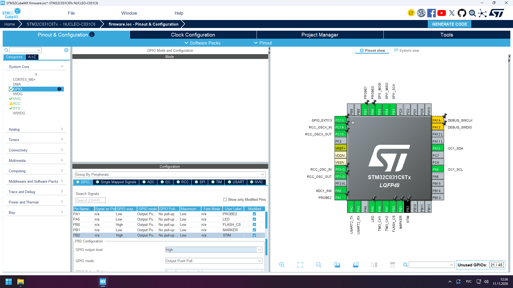
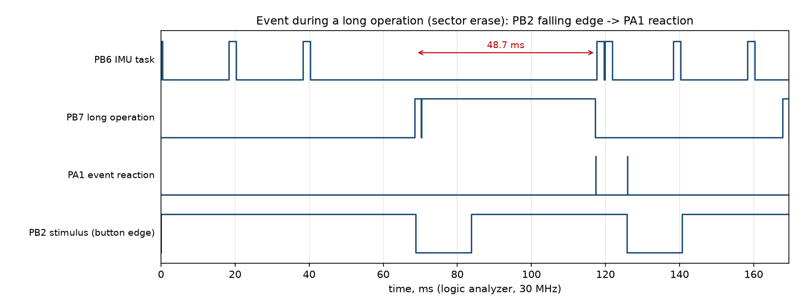
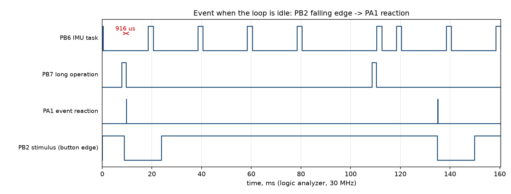
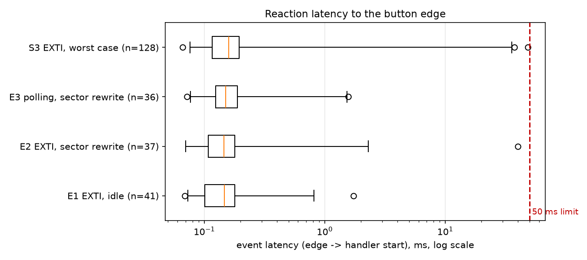
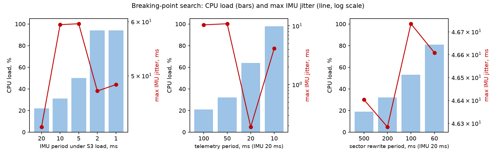

## Тема

Bare metal super loop: вимірювання продуктивності та пам'яті, пошук меж застосовності архітектури без ОС.

## Мета роботи

Зібрати в одній прошивці всі функції продукту Motion-Mirroring Teleoperator (FR-01…FR-11) у вигляді головного циклу super loop, виміряти його часові характеристики (час виконання задач, джитер, затримку реакції на подію, завантаження CPU) і використання пам'яті (flash, RAM, стек, heap), знайти навантаження, за якого вимоги PRD перестають виконуватись, оформити знайдені межі як реєстр обмежень і на виміряних числах відповісти, чи потрібна продукту ОС.

## Форма виконання

Форма B (симулятор Wokwi), індивідуально. Плата NUCLEO-C031C6 (STM32C031C6, Cortex-M0+, 48 МГц, 32 КБ flash, 12 КБ RAM). Фізичного стенда немає, тому всі числа – **симуляторні**: Wokwi не відтворює такти кристала точно (час стирання flash задає власна модель W25Q64, а не кристал), отже, достовірними вважаємо відносні величини і збіг двох способів вимірювання, а абсолютні часи шин – лише як оцінку (розд. 8, обмеження вимірювань). Логічний аналізатор – `wokwi-logic-analyzer`, записи аналізуються `tools/lr3_vcd.py` і sigrok-cli. Репозиторій: `Zenzoik/lab-1-sprg`, гілка `lab3`, тег `lab3`.

## 1. Статус вимог PRD

Верифікація кожної FR – у тому сценарії, де її можна перевірити у цій прошивці; джерело чисел – `docs/metrics/`. Реєстр обмежень (`docs/limitations.md`) далі позначено як **LIM-n**.

| FR | Вимога | Статус | Сценарій / доказ | Обмеження |
|---|---|---|---|---|
| FR-01 | `hello` < 1 с | Виконана | `boot 5`: перше повідомлення через 7 мс, самотест завершено за 146 мс (pass=8 fail=0), стабільно у 5 запусках | – |
| FR-02 | Виявлення MPU-6050, діагностика | Виконана | самотест, `whoami`, F1_sensor (втрата → `ERROR`) | LIM-5 |
| FR-03 | Опитування IMU ≥ 50 Гц | **З обмеженням** | S1: max інтервал 20,1 мс, пропусків 0; S2: 66,8 мс, пропущено 2; S3: 79,3 мс, пропущено 61 | LIM-2, LIM-3 |
| FR-04 | Похибка кута ≤ 5° | Виконана | хостові тести `motion` (0°, ±45°, ±90°); у S1–S3 кут обчислюється тим самим кодом | – |
| FR-05 | Керування сервоприводами, 1000–2000 мкс / 20 мс | Виконана | PWM лишається 1000–2000 мкс при кожному навантаженні (команда `pwm`, тести) | – |
| FR-06 | Затримка «зміна → PWM» < 50 мс | **З обмеженням** | S1: 22,2 мс; S2: 68,9 мс; S3: 81,4 мс (найгірший випадок: max інтервал + обробка 2,1 мс) | LIM-1, LIM-2 |
| FR-07 | Потенціометр керує амплітудою | Виконана | команда `adc`, ЛР2 | – |
| FR-08 | Кнопка: центрування, режим | **З обмеженням** | у симуляторі `press 100` → подія без зміни режиму (`ev_lat` 1,7 мс), `press 1500` → перемикання Hold/Live (`MODE live`, `docs/metrics/fr08_press.log`); S2: затримка події max 2,0 мс; S3: 46,5 і 58,7 мс (DR-2 ≤ 50 мс порушена в одному з двох прогонів); хостові тести кнопки | LIM-1 |
| FR-09 | Індикація LD4 за режимом | Виконана | хостові тести LED; в S3 фаза блимання зсувається не більше ніж на 1 період задачі | LIM-2 |
| FR-10 | 10 ± 1 рядок телеметрії за 10 с | **З обмеженням** | S2: 1 рядок/с стабільно; у S3 (200 мс) телеметрія забирає до 26 % CPU; при періоді 10 мс завантаження 98 % | LIM-3 |
| FR-11 | Відмова датчика: PWM = 1500 мкс, повідомлення | Виконана | F1_sensor: перехід у `ERROR`, відновлення, `recover` max 4,67 мс | LIM-5 |

Додатково перевірено (методичка, розд. 6.3): FR-06 для S1 < 50 мс (22,2 мс), для S2 і S3 **не виконується** – це і є головний результат ЛР3 щодо архітектури, див. розд. 5–7.

## 2. Опис прошивки

### 2.1 Структура головного циклу

`main()` після ініціалізації периферії і самотесту виконує нескінченний цикл `while (1) { app_poll(); }`. `app_poll()` (`firmware/App/app.c`) послідовно викликає задачі; кожна задача сама перевіряє за лічильником часу, чи настав її момент, і якщо ні – одразу повертає керування. Порядок і періоди задач – у `docs/tasks.md`.

```text
        +--------------------------- while (1) ----------------------------+
        |                                                                  |
        v                                                                  |
   +---------+   +-------+   +-----+   +-----+   +-----+   +-----+   +-----+--+
   |  cli    |-->| event |-->| imu |-->| led |-->| tlm |-->| jrn |-->| lop |  |
   | USART2  |   | кнопка|   | 20мс|   |     |   | UART|   |flash|   | 1 с |  |
   +---------+   +-------+   +-----+   +-----+   +-----+   +-----+   +-----+--+
        ^             ^          |                                      |
        |             |          v                                      v
     RX-кільце     EXTI-черга  PWM (TIM3)                      recover, load, перевірка кінця сценарію
        ^             ^
        | ISR         | ISR (EXTI4_15, PC13)
     USART2        SysTick (1 мс, лічильник часу)
```

Задачі й періоди (S3 – найважчий режим): `imu` 20 мс, `tlm` 200 мс, `jrn` 100 мс, `lop` 1 с, `led` 500/100 мс, `cli` і `event` – за подією. Дедлайни: `imu` – наступний запуск не пізніше ніж через 20 мс (FR-03), `ctl_lat` < 50 мс (FR-06), `event` ≤ 50 мс (DR-2, похідна, бо PRD для кнопки числа не дає).

### 2.2 Використані переривання

| Переривання | Навіщо | Пріоритет |
|---|---|---|
| SysTick (1 кГц) | лічильник часу `millis` і база 32-бітного лічильника циклів (`m·(LOAD+1) + (LOAD − VAL)`) | 0 (найвищий) |
| EXTI4_15 (PC13) | фіксація фронту кнопки із міткою часу в кільцевій черзі подій (не обробка події) | 1 |
| USART2 RX | прийом байта в кільцевий буфер; обробка – у `cli` | 2 |

В ISR немає викликів HAL з timeout, форматування рядків і доступу до flash: ISR лише кладуть мітку або байт у кільцевий буфер і повертаються. Обробка події виконується в головному циклі, тому реакція не може бути швидшою за найдовшу задачу циклу (формула – у розд. 5.4).

Режим опитування (`set btn poll`) використовується для порівняння з EXTI (сценарій E3). Зворотній перехід `btn_mode_set` викликає `HAL_GPIO_DeInit` перед `HAL_GPIO_Init` – див. проблему 2.

### 2.3 Вимірювальний код і службові піни

- Лічильник циклів: Cortex-M0+ не має DWT, тому використано SysTick (24-бітний лічильник + лічильник переповнень); різниця двох 32-бітних беззнакових значень коректна для інтервалів < 89 с (період 2³² тактів при 48 МГц).
- `perf.c`: для кожної задачі `n / min / avg / max` у мікросекундах, гістограма джитера (межі 100, 500, 1000, 5000, 20000 мкс), завантаження CPU за вікном 1 с.
- Піни: PB6 – вікно задачі `imu` (D0), PB7 – довга операція (D1), PA1 – реакція на подію (D2), PB2 – стимул (D3). PB2 з'єднано з PC13 шлейфом в `diagram.json`.
- Команди: `scn`, `set`, `stats`, `jit`, `mem`, `rx`, `evlog`, `press`, `jv`, `jtorn`, `ping`, `reboot`. Рядки результатів машинозчитувані (`SCN`, `STAT`, `JIT`, `MEM`, `RX`, `EVLOG`, `EVT`, `JOURNAL`).
- Час у логах береться з лічильника МК (поле `t_us`), а не з часу прибуття рядка на хост (контрольне питання 5).




## 3. Методика вимірювань

1. **Один код – чотири сценарії.** S1/S2/S3 і сценарії 6.2 задаються таблицею `k_cfg` і командами `set`; збірка однакова (`git=f96e864-dirty` у `SCN BEGIN`), оптимізація `-Os -flto`. Прогін запускає `tools/run_scenarios.py` (команди по символу з паузою 20 мс, завершення `\r`), сирий лог зберігається в `docs/metrics/<сценарій>.log`.
2. **Лічильник МК.** Інтервали виміряно різницею значень лічильника циклів; кожен рядок результату містить `n`, `min`, `avg`, `max` (мкс). Максимум береться по всьому прогону, не по вікну.
3. **Логічний аналізатор.** У Wokwi запис експортується в `wokwi.vcd` після натискання Stop; аналіз – `tools/lr3_vcd.py pulses`, `events`. Ємність буфера тригерного режиму (≈ 33 мс) недостатня для S3, тому використано експорт усієї сесії (проблема 5).
4. **Джитер** = (фактичний інтервал між запусками `imu`) − 20 мс; пропуск періоду рахується, коли фактичний інтервал ≥ 1,5 періоду. Після пропуску задача не «наздоганяє» втрачені періоди, а продовжує з наступної планової миті.
5. **Затримка реакції** = від фронту PB2 (стимул) до фронту PA1 (початок обробки). У прошивці та сама величина обчислюється за міткою EXTI і лічильником (`EVT lat_us`).
6. **Пам'ять.** flash/RAM – `--print-memory-usage`; найбільші символи – `arm-none-eabi-nm --size-sort`; статичний стек – `tools/stack_static.sh` (`-fstack-usage` на нелінкованих об'єктах, бо LTO не дає `.su`); виміряний стек – stack painting від `_end` до вершини; heap – `_sbrk(0) − &_end`.
7. **Відтворюваність.** Генератор стимулу (xorshift32, фіксоване зерно) дає однакову послідовність натискань; повторні прогони S3 дали max затримки 46,5 і 58,7 мс (різниця пов'язана з фазою `lop` відносно натискань, а не з випадковістю вимірювання).

## 4. Результати

### 4.1 S1, S2, S3

| Метрика | S1 | S2 | S3 | Вимога |
|---|---|---|---|---|
| Виконання `imu`, avg / max | 2,08 / 2,09 мс | 2,08 / 2,12 мс | 2,08 / 2,17 мс | – |
| Max інтервал між запусками `imu` | 20,1 мс | 66,8 мс | 79,3 мс | ≤ 20 мс |
| Max джитер `imu` | 0,13 мс (−111 / +125 мкс) | 46,8 мс | 59,3 мс | – |
| Пропущено періодів | 0 | 2 | 61 | 0 |
| `ctl_lat` (виміряна від запланованої миті), max | 2,17 мс | 14,1 мс | 21,4 мс | < 50 мс |
| FR-06, найгірший випадок (max інтервал + 2,1 мс) | 22,2 мс | 68,9 мс | 81,4 мс | < 50 мс |
| Затримка події, max | – | 1,98 мс (n=27) | 46,5 / 58,7 мс (n=211 / 214), p50 ≈ 159 мкс | ≤ 50 мс |
| Завантаження CPU, avg / max | 10 / 11 % | 12 / 16 % | 22 / 26 % | – |
| Max затримка циклу | 2,30 мс | 47,4 мс | 59,7 мс | – |
| Телеметрія, max | – | 10,65 мс | – | – |
| Запис журналу, max | – | 47,2 мс | – | – |
| Стек (виміряно) | 1128 Б | 1128 Б | 1112 Б | резерв 2048 Б |
| Heap | 0 | 0 | 0 | – |

Порівняння з розрахунком: час `imu` 2,08 мс = 1,37 мс (читання 14 байт I²C при 100 кГц, ЛР2) + 0,7 мс обчислень і SPI; очікуване завантаження S1 = 2,08 / 20 = 10,4 % – збігається з виміряними 10 %. Для S3 розрахунок «задачі додаються» дає: `imu` 10,4 % + `tlm` (≈ 5 мс / 200 мс = 2,5 %) + `jrn` (≈ 1,5 мс / 100 мс) + `lop` (≈ 46,9 мс / 1000 мс = 4,7 %, із них решта – чекання готовності flash) ≈ 20 %, виміряно 22 % (середнє) – різницю дають обробка подій і CLI. Середнє навантаження 22 % виглядає безпечним, але максимум інтервалу 79 мс показує, що важлива не сума, а найдовша **неперервна** задача: стирання сектора блокує цикл на 45 мс (час моделі W25Q64).

### 4.2 Два способи вимірювання однієї метрики

| Метрика | Лічильник МК | Логічний аналізатор | Різниця |
|---|---|---|---|
| Затримка події (стимул → PA1), 128 подій S3 | max 48,65 мс, p50 ≈ 159 мкс | max 48,65 мс | 3,4–4,5 мкс на подію (крок дискретизації аналізатора) |
| Тривалість вікна `imu` (PB6) | 2082 мкс | 2021 мкс | −61 мкс (−2,9 %): лічильник включає виклик `perf_end`/міток, пін – лише тіло задачі |
| Max інтервал між запусками `imu` в S3 | 79,3 мс | 79,3 мс | у межах кроку |

Затримка події збіглась на всіх 128 парах до 4,5 мкс; тривалість `imu` розходиться на 2,9 % через різні точки відліку (пін піднімається після входу в задачу). Висновок: лічильник МК придатний для всіх подальших вимірювань, а розбіжність відома і мала.





### 4.3 Сценарії 6.2

**Сценарій 1 – довга операція + періодична (L1).**

| | Без `lop` (L1_baseline) | Зі стиранням flash (L1_flash) |
|---|---|---|
| Запусків `imu` за 20 с | 999 | 961 |
| Max джитер | 118 мкс | 46,5 мс |
| Пропущено періодів | 0 | 38 |

Одна довга операція (45 мс) раз на секунду руйнує періодичність: за прогін втрачено 38 запусків з 1000 (3,8 %). Друге значення – 46,5 мс = тривалість стирання + решта циклу.

**Сценарій 2 – подія під час довгої операції (E1/E2/E3).**

| | E1: EXTI, цикл вільний | E2: EXTI, `lop` 500 мс | E3: опитування, `lop` 500 мс |
|---|---|---|---|
| Подій | 41 | 37 | 36 (із 37) |
| Max затримка | 1,73 мс | 40,2 мс | 1,56 мс |

Для E2 затримка = залишок довгої операції, і max наближається до її повної тривалості (45 мс). У E3 максимум малий лише тому, що опитування пропустило одну подію (переживання відбору): вона потрапила в стирання і зникла – у реальному пристрої це втрата натискання. Тому режим опитування в продукті неприйнятний, а EXTI з чергою подій зберігає всі події, але не прискорює їхньої обробки (LIM-1).



**Сценарій 3 – потік команд UART (U1/U2).**

| | U1 (S2) | U2 (S3) |
|---|---|---|
| Надіслано `ping` | 7920 | 7960 |
| Прийнято байтів | 7850 | 15 098 (подвійний вивід відповідей) |
| Відповідей `PONG` | 1051 | 844 |
| Невпізнаних команд | 1065 | 896 |
| Лічильник overrun | 0 | 0 |

З 7920 команд оброблено лише 1051 (13 %) у S2 і 844 (11 %) у S3, решта втрачена: кільцевий буфер приймача переповнюється, поки цикл зайнятий блокувальною передачею телеметрії і стиранням. Лічильник overrun при цьому показує 0, бо Wokwi не емулює прапор ORE, хоча байти втрачено (обмеження вимірювань). Реальна втрата перевірена за балансом «надіслано − оброблено».

**Сценарій 4 – відмова датчика (F1_sensor, 40 с).**

| | Значення |
|---|---|
| Max час `imu` | 3,69 мс |
| `recover`, n / max | 12 / 4,67 мс |
| Max пауза між відліками (JIT) | 11,98 с |
| Пропущено періодів | 599 |

Прошивка переходить у режим помилки, обидва канали PWM встановлюються в 1500 мкс, повідомлення виводиться, після повернення датчика режим відновлюється. Пауза 11,98 с – це свідомо зроблена зупинка опитування на час втрати (опитування відновлюється кожну секунду), а не блокування циклу. На реальному залізі I²C із відсутнім датчиком чекає timeout 20 мс на транзакцію – це оцінка за кодом, не вимір (розд. 8).

**Сценарій 5 – пошук точки зламу (B_*).**

| Параметр | Значення | Завантаження | Результат |
|---|---|---|---|
| `imu` 20 / 10 / 5 / 2 мс | ефективний період ≈ 20 / 10 / 5 / 2,55 мс | до 94 % | при 1 мс ефективний період 2,55 мс, пропущено 6072 |
| `tlm` 100 / 50 / 20 / 10 мс | – | 98 % при 10 мс | цикл майже не залишає часу іншим задачам |
| `lop` 500 / 200 / 100 / 60 мс | – | 81 % при 60 мс | `imu` пропускає ~75 % запусків |

Точки зламу для продукту: `imu` вже при 1 мс (ефективний період 2,55 мс = час самої задачі + накладні витрати); `tlm` з періодом 10 мс; `lop` з періодом 60 мс.



**Сценарій 6 – тривала робота (S2, 3600 с).** Прогін `long 3600` (S2, 1 година симуляційного часу; фактичний `SCN END` на t = 3728 с, бо команди оператора теж виконуються в циклі); кожні 5 хвилин виводяться `mem`, `jv`, `rx`. Результат – у розд. 4.5.

**Сценарій 7 – старт і перезапуск (boot ×5).** Усі п'ять запусків ідентичні: `SELFTEST BEGIN` через 7 мс, `RESULT` через 146 мс (pass=8 fail=0), остання подія `PWM_DEMO` на 389 мс. Дрейфу немає (детермінований симулятор).

**Сценарій 8 – цілісність журналу (J1).** Після `scn 2 15` журнал чистий: `good=625 bad=0`. Команда `jtorn` імітує обірваний запис (запис без другої половини); `jv` після неї виявляє `bad=1` – CRC-16 ловить пошкоджений запис, наступні записи не втрачаються, `erases=3`.

### 4.4 Анотований запис логічного аналізатора

Файл `docs/captures/lr3_event_during_longop.vcd`: канали D0 = PB6 (`imu`), D1 = PB7 (довга операція), D2 = PA1 (реакція), D3 = PB2 (стимул). На рис. 3: (1) фронт PB2 – натискання у момент, коли PB7 у високому рівні (триває стирання сектора); (2) PB7 падає через 45 мс; (3) лише після цього піднімається PA1 – реакція на подію; (4) `imu` (PB6) у цей час пропускає два вікна. Виміряна затримка події на цьому фрагменті – 40,2 мс (E2) і до 48,65 мс у S3.

### 4.5 Тривала робота

Сирий лог – `docs/metrics/long_s2.log`. Підсумок `SCN END` (t = 3 728 239 мс):

| Метрика | Значення |
|---|---|
| `imu`: n / avg / max | 179 581 / 2087 мкс / 2158 мкс |
| `ctl_lat` max | 21,9 мс |
| `telemetry`: n / avg / max | 3599 / 10,84 / 10,96 мс |
| `journal`: n / max | 7189 / 47,2 мс |
| `ev_lat`: n / avg | 3835 / 1,12 мс |
| Завантаження CPU, avg / max | 12 % / 79 % |
| Stack (`mem`, 12 вибірок) | 1128 Б, без змін |
| Heap | 0 Б, без змін |
| `JOURNAL` (12 перевірок) | `bad=0`, `errors=0`; `good` коливається 781–960 (сектор журналу стирається по колу), `erases` зросло 3 → 26 |
| Лічильник UART | `overruns=0` |

Висновки: (1) стек і heap за годину не змінились – витоків і росту стека немає; (2) середній час `imu` (2087 мкс) практично збігається з прогоном на 30 с (2082 мкс), тому 32-бітний лічильник циклів коректно перетнув межу переповнення 89 с близько 40 разів (3728 / 89,4) без жодного збою; (3) журнал лишився цілим після 26 стирань сектора.

Великі максимуми в цьому прогоні (`loop` max 769 мс, `ev_lat` max 708 мс, `JIT` max 751 мс, `missed` = 418, `load` max 79 %) спричинені **не навантаженням S2, а оператором**: команда `jv` (повна перевірка журналу з читанням flash) виконується в циклі синхронно і блокує його ≈ 0,75 с (`STAT name=cli max_us=754114`); таких команд за годину було 12, тобто ≈ 35 пропущених періодів на команду. Тому для метрик S2 використовується прогін на 30 с (розд. 4.1), а цей прогін – для стабільності пам'яті, лічильника і журналу. Сама ця поведінка є ще одним прикладом LIM-1: довга команда CLI блокує реакцію на 0,7 с.

## 5. Використання пам'яті

### 5.1 Flash і RAM

Вивід `--print-memory-usage` (LTO, `-Os`):

```text
Memory region         Used Size  Region Size  %age Used
           FLASH:       29156 B        32 KB     88.98%
             RAM:        5128 B        12 KB     41.73%
```

`.data` = 120 Б, `.bss` = 2448 Б, зарезервований стек `_Min_Stack_Size` = 2 КБ (0x800); решта RAM – буфери вимірювань (кільця подій, гістограми, протокол). Без LTO збірка не вміщується у flash (104 %), тому LTO обов'язковий (проблема 4). Запас flash лише 11 % – це **обмеження ресурсів для ЛР4**: додавання RTOS (FreeRTOS ≈ 6–10 КБ flash для M0+) не вміститься без вимкнення частини діагностики.

### 5.2 Найбільші символи

Файл `docs/metrics/memory_symbols.txt` (`nm --size-sort`, секції `size -A`). Найбільші символи: `main` 7460 Б (під LTO у нього вбудовано `app_poll` і задачі), `g_app` 1576 Б у `.bss` (стан застосунку, кільця подій і RX), `app_selftest` 1056 Б, `MX_ADC1_Init` 796 Б, `_printf_i` 648 Б, `_svfprintf_r` 572 Б; `.text` = 25 084 Б, `.rodata` = 3572 Б. Розподіл показує, що значну частину flash займають newlib-функції форматування (`_svfprintf_r`, `_printf_i`, `__divdi3`, `__udivmoddi4`) – це кандидат на економію в ЛР4.

### 5.3 Стек: статична оцінка проти виміряної

| Спосіб | Значення | Коментар |
|---|---|---|
| Статична (`-fstack-usage`, `tools/stack_static.sh`) | найбільші кадри (`docs/metrics/stack_static.txt`): `app_selftest` 240 Б, `emit` 176 Б, `app_handle_line` 160 Б, `app_poll` 128 Б; шлях `app_poll → app_handle_line → emit` дає ≈ 464 Б без кадрів newlib | newlib (`printf`) не має даних `.su`, ISR і виклики через вказівники не враховано |
| Виміряна (stack painting) | 1128 Б (S1, S2), 1112 Б (S3) | включає вкладення ISR поверх виклику `printf` |
| Резерв | 2048 Б, запас 920 Б (45 %) | – |

Виміряна глибина більша за статичну, бо статична оцінка не бачить викликів через вказівники (таблиця команд) і стек ISR, який накладається на стек найглибшого виклику. Перше вимірювання з резервом 1 КБ дало 1024 Б (насичення) – справжнє використання 1128 Б перевищувало резерв (проблема 1). Heap = 0: динамічна пам'ять не використовується (`_sbrk(0) − &_end = 0`).

## 6. Реєстр обмежень (зведення)

Повністю – `docs/limitations.md`. Для кожного обмеження наведено доказ (сценарій, число), що дала б ОС і чого вона коштуватиме.

| № | Обмеження | Доказ | Що дасть ОС (ЛР4) | Ціна |
|---|---|---|---|---|
| LIM-1 | Затримка реакції на подію = найдовша задача циклу | E2: 40,2 мс; S3: 46,5–58,7 мс проти 0,16 мс у вільному циклі | пріоритетне переривання задачі, реакція < 1 мс | перемикання контексту, спільні дані, пріоритетна інверсія |
| LIM-2 | Довга операція руйнує періодичність `imu` | L1_flash: джитер 46,5 мс, 38 пропусків | `imu` витісняє `lop`: джитер до 0,1–0,3 мс | RAM під стеки, flash під ядро |
| LIM-3 | Блокувальна передача телеметрії | B_tlm_4 (10 мс): завантаження 98 % | передача в окремій задачі, черга | черга + задача + RAM |
| LIM-4 | Втрата байтів приймача UART | U1/U2: оброблено 11–13 % з 7900 команд | розв'язується DMA/перериванням, а не ОС | – |
| LIM-5 | Відмова датчика блокує цикл на timeout | F1: пауза до відновлення; 20 мс/транзакцію на залізі (оцінка) | блокується лише задача, що чекає | таймаути у кожній задачі |
| LIM-6 | Нова задача змінює код у багатьох місцях | додавання `lop`: ≈ 10 змін у `app.c` | реєстрація задачі в одному місці | – |
| LIM-7 | Спільний стек усіх задач | 1128 Б для всього | стек на кожну задачу (3–5 × ~512 Б) | RAM росте у 3–5 разів |

## 7. Висновок: чи потрібна продукту ОС

Для режимів S1 і S2 super loop достатній: S1 виконує FR-03 і FR-06 із запасом (інтервал 20,1 мс, 22,2 мс < 50 мс, завантаження 10 %), а S2 порушує лише FR-06 у найгіршому випадку (68,9 мс) через запис журналу. Режим S3 (найгірший) у super loop **не виконує** FR-06 (81,4 мс проти 50 мс), FR-03 (79,3 мс замість 20 мс, 61 пропущений період) і DR-2 (58,7 мс проти 50 мс), хоча середнє завантаження CPU всього 22 %. Причина не в нестачі обчислювальної потужності, а в тому, що в циклі є неперервні блокувальні задачі (стирання flash 45 мс, передача телеметрії, запис журналу), які не можна витіснити. Отже, продукту, що має одночасно вести журнал у flash і тримати керування 50 Гц, **потрібен механізм витіснення**, тобто RTOS або принаймні друга черга пріоритетних переривань і розбиття довгих операцій на кроки (конкурентний варіант без ОС). Вибір на користь RTOS: LIM-1, LIM-2, LIM-3 і LIM-5 розв'язуються пріоритетами і чергами; LIM-4 розв'язується DMA і не залежить від ОС. Ціна: flash залишилось 11 % (3,6 КБ) – ядро RTOS потребує вимкнення частини діагностики; RAM під стеки вчетверо більше. Тому ЛР4 починається з бюджету пам'яті (`docs/baseline-lab4.md`, розд. 4).

## 8. Обмеження вимірювань

- Wokwi не є циклоточним: час стирання 45 мс задає модель W25Q64; на кристалі sector erase зазвичай 45–400 мс (datasheet), тому на залізі цифри LIM-1/LIM-2 можуть бути гіршими.
- Лічильник overrun UART у Wokwi завжди 0, хоча байти втрачено; втрату встановлено за балансом команд.
- Тайм-аут датчика на залізі (20 мс) – оцінка за кодом; виміряна лише пауза при відсутності датчика в симуляторі.
- Обидва прогони S3 дали різні max затримки (46,5 і 58,7 мс); для вимог приймається більше значення.
- Лічильник циклів і піни показують різні точки відліку (різниця 2,9 % для `imu`).

## 9. Журнал проблем

| № | Симптом | Root cause | Виправлення |
|---|---|---|---|
| 1 | Виміряний стек зупинявся на 1024 Б (насичення) при резерві 1 КБ | stack painting малювався лише в межах резерву, а не від `_end`, тому показання насичувалось; справжня глибина 1128 Б > резерву 1024 Б, тобто стек заходив у `.bss` | `stack_lo()` повертає вирівняний `&_end`, `_Min_Stack_Size` збільшено до 0x800; комміт 2bda0a5 |
| 2 | У режимі опитування (`btn poll`) кожне натискання давало дві події | `HAL_GPIO_Init(INPUT)` не знімає EXTI, лінія лишалась озброєною | `HAL_GPIO_DeInit` перед повторною ініціалізацією; E3 перезапущено; комміт 2bda0a5 |
| 3 | Команди не доходили або приходило `unknown command` | у Wokwi CLI-термінал губить байти при пакетному запису і потребує `\r`, а не `\n` | `Dev.send` друкує по символу з паузою 20 мс (`LR3_CHAR_DELAY`) і додає `\r`; комміт e8e015a |
| 4 | Лінкер: «region FLASH overflowed», 104 % | без LTO вимірювальний код і діагностика не вміщуються у 32 КБ | `-flto -Os`: 88,98 % flash; `-fstack-usage` не працює під LTO → `tools/stack_static.sh`; комміт 0c132cc |
| 5 | Запис аналізатора обривається на ≈ 33 мс (S3 – порожній) | буфер тригерного режиму `wokwi-logic-analyzer` обмежений | запис усієї сесії за кнопкою Stop (`wokwi.vcd`); `tools/lr3_vcd.py window` вирізає фрагмент; тригер не потрібен; комміт e8e015a |
| 6 | `ctl_lat` у S3 показувала 21 мс при максимальному інтервалі між відліками 79 мс | `ctl_lat` рахується від запланованої миті відліку, пропущені відліки в неї не входять | пропуски рахуються окремо (`missed`), для FR-06 використовується max інтервал + обробка 2,1 мс; комміт 2bda0a5 |
| 7 | Довгий прогін S2 переривався | зміна ELF перезапускає симулятор і обриває фоновий прогін | перезбірка лише між прогонами; довгі завдання запускаються окремим процесом; комміт e8e015a |

## 10. Внесок учасників

Індивідуальна робота (форма B); всі ролі виконав один студент.

| Роль | Відповідальний | Артефакти |
|---|---|---|
| Прошивка і вимірювальний код | Зернишкін І. Д. | `firmware/App/`, `firmware/Platform/`, тести |
| Сценарії і хост-скрипти | Зернишкін І. Д. | `tools/run_scenarios.py`, `tools/lr3_vcd.py`, `docs/metrics/` |
| Логічний аналізатор | Зернишкін І. Д. | `docs/captures/`, рис. 3–4 |
| Тестування на обладнанні | – (немає стенда, форма B) | замінено симуляцією, див. розд. 8 |
| Звіт, реєстр обмежень, базова лінія | Зернишкін І. Д. | `docs/limitations.md`, `docs/baseline-lab4.md`, цей звіт |

Повна історія – у `git log` гілки `lab3`.

## 11. Сценарій відеозвіту (2–3 хв)

1. (0:00–0:20) Показати схему в Wokwi, термінал і команду `scn 3 30`; пояснити, що S3 – усе навантаження одночасно.
2. (0:20–1:00) У терміналі йдуть рядки `STAT`, видно `LOAD` 22 %; показати натискання кнопки (`press`) під час довгої операції і рядок `EVT lat_us` із запізненням до 58 мс.
3. (1:00–1:40) Відкрити PulseView з `lr3_event_during_longop.vcd`: PB2 (стимул) → PB7 (триває стирання) → PA1 (реакція лише після завершення). Показати вимір курсорами – 40–48 мс.
4. (1:40–2:20) Для порівняння – `lr3_event_idle_loop.vcd`: реакція 160 мкс. Звернути увагу на різницю у 250 разів.
5. (2:20–2:50) Висновок: S3 порушує FR-06; super loop не підходить, ЛР4 – RTOS; показати таблицю бюджету пам'яті.

## 12. Відповіді на контрольні питання

1. **Головний цикл.** `while (1) { app_poll(); }`, у `app_poll` задачі `cli → event → imu → led → tlm → jrn → lop → recover → load`; кожна перевіряє свою мітку часу. Найгірша затримка реакції на подію: **T_resp = T_longest + T_isr + T_event**, де T_longest – найдовший непереривний фрагмент іншої задачі. У нас T_longest = 45 мс (стирання сектора), T_event ≈ 0,16 мс, тому T_resp ≈ 45,2 мс; виміряно max 46,5–58,7 мс (в S3 до цього додається ще `tlm` і `jrn`).
2. **Джитер.** Відхилення фактичного інтервалу між запусками періодичної задачі від номінального періоду. Виміряно як (інтервал − 20 мс) лічильником МК (`JIT`): S1 −111/+125 мкс, S2 46,8 мс, S3 59,3 мс. Причина – задачі, що виконуються між запусками `imu`, насамперед стирання flash і передача телеметрії.
3. **Найгірший час.** Дедлайн порушується в найгіршому випадку, а не в середньому: середнє завантаження S3 – 22 %, але max інтервал 79 мс. Справжність максимуму перевірено двома способами (лічильник і аналізатор дали однакові 79,3 мс і 48,65 мс), двома прогонами S3 та довгим прогоном.
4. **Лічильник циклів.** Cortex-M0+ не має DWT, тому лічильник побудовано на SysTick: `m·(LOAD+1) + (LOAD−VAL)`, де `m` – кількість переповнень. Різниця двох беззнакових 32-бітних значень коректна за модулем 2³², тому переповнення не заважає, поки інтервал < 2³² тактів = 89 с (при 48 МГц). Довше цього інтервалу відрізнити період від нуля неможливо.
5. **Час прибуття рядка на хості.** Він включає буферизацію USB/віртуального порту, планувальник ОС хоста і швидкість передачі: розкид – мілісекунди, більше за самі виміри. Час береться з лічильника МК (`t_us`) і з аналізатора.
6. **ISR.** Можна: зчитати прапор, покласти мітку в кільцевий буфер, скинути EXTI, встановити `volatile`-прапор. Не можна: блокувальні виклики, `printf`, доступ до flash, HAL з timeout. HAL-функція з timeout у ISR покладається на `HAL_GetTick`, який оновлюється в SysTick; при такому ж або нижчому пріоритеті SysTick не спрацює, і виклик зависне до скінчення timeout або назавжди.
7. **`volatile`.** Гарантує, що компілятор не кешує значення в регістрі і виконує кожен доступ. Не гарантує атомарності і порядку для кількох змінних: 32-бітне читання на M0+ атомарне, але структура «індекс голови + дані» – ні. У нашому коді кільце подій (`head`, `tail`, `buf`) оновлюється в ISR і читається в циклі; поряд із `volatile` потрібна послідовність «записати дані → потім індекс» і одноразове читання індексу локально.
8. **text / data / bss.** `text` – код і константи у flash, `data` – ініціалізовані змінні (копіюються з flash у RAM), `bss` – обнулені змінні в RAM. Стек і heap тут не видно, бо їхній розмір визначається під час роботи, а не при компіляції; для нас: `.data` 120 Б, `.bss` 2448 Б, а використання стека 1128 Б видно лише через stack painting.
9. **Статичний проти виміряного стек.** Статичний (`-fstack-usage`) – сума кадрів на найглибшому шляху виклику, не бачить викликів через вказівники й ISR. Виміряний (stack painting) – реальна глибина за прогін, але тільки для виконаних шляхів. У нашому продукті більша виміряна (1128 Б), бо вона включає ISR поверх виклику `printf` і виклики через таблицю команд.
10. **RAM і кадр камери.** Камери в нашому проєкті немає (форма B, STM32C031 не має DCMI); для оцінки: RAM 12 КБ, з яких 5128 Б зайнято, лишається ≈ 7 КБ, тобто кадр 80×60 у 8-бітному градаціях сірого (4800 Б) вміщується, а 160×120 (19 200 Б) – ні. Тому довга операція «захоплення кадру» замінена стиранням flash як навантаженням.
11. **Датчик на I²C перестав відповідати.** Транзакція чекає timeout (за кодом 20 мс), після помилки прошивка переходить у режим помилки і опитує датчик раз на секунду. У симуляторі пауза між відліками під час втрати 11,98 с (свідомо), `recover` виконується до 4,67 мс. Поки транзакція чекає, інші задачі не виконуються, тобто до 20 мс затримки на кожну спробу (оцінка).
12. **Найсерйозніше обмеження.** LIM-1/LIM-2: довга неперервна операція (стирання flash 45 мс) блокує і реакцію на подію, і періодичну задачу. Розв'язує його витісняюча ОС: пріоритетна задача `imu` і `event` перериває `lop`. Нові ризики: гонки між задачами за спільні дані, пріоритетна інверсія, більше RAM (стек на кожну задачу), складніше налагодження і ядро ≈ 6–10 КБ flash при 3,6 КБ вільних.
13. **Де super loop кращий.** Детермінованість без перемикань контексту, найменший розмір (flash 29 КБ без ядра), один стек (1128 Б), немає пріоритетної інверсії, простий аналіз найгіршого випадку формулою; на S1 завантаження 10 % і джитер 0,13 мс – ОС тут нічого не додає.

## Додаток. Скриншоти


Вивід перевірок (`make test`, `make check-pinout`):

```text
  [ ok ] recovery: sensor comes back (FR-11)
  [ ok ] recovery: one attempt per second
  [ ok ] cmd: set
  [ ok ] cmd: scn argument check
  [ ok ] cmd: ping, press, mem, rx, jv, jtorn, reboot
  [ ok ] scenario: UART receiver statistics
PASSED: 0 test(s) failed        (98 перевірок: 69 з ЛР2 і 29 нових)
check-pinout: 18 rows, 0 errors
```

Перевірка FR-08 у симуляторі (`docs/metrics/fr08_press.log`):

```text
>> press 100        CMD press ms=100     (коротке натискання: режим не змінився)
>> press 1500       CMD press ms=1500
MODE live                                (довге натискання: перемикання Hold -> Live)
```
